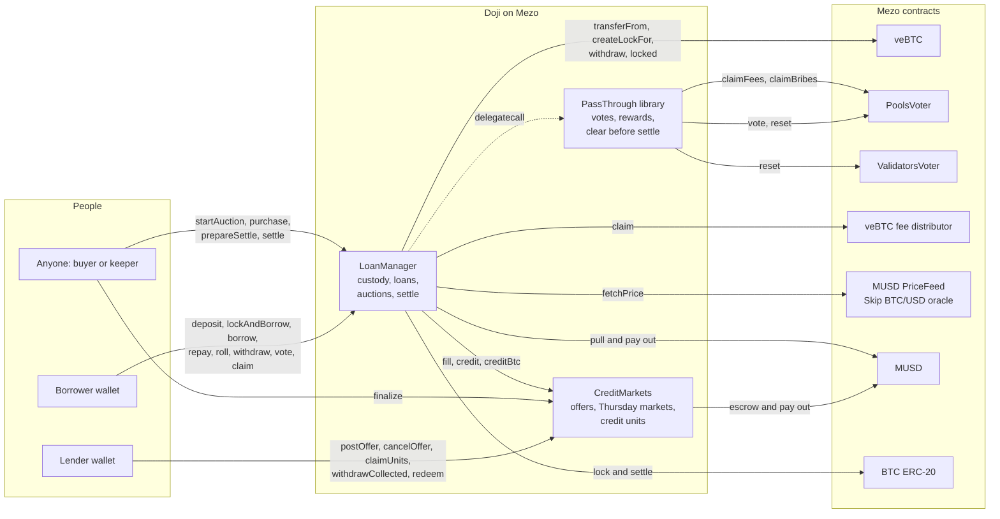
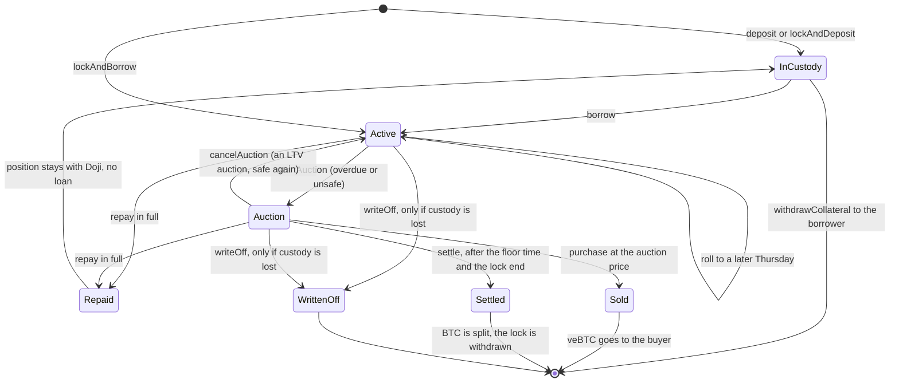
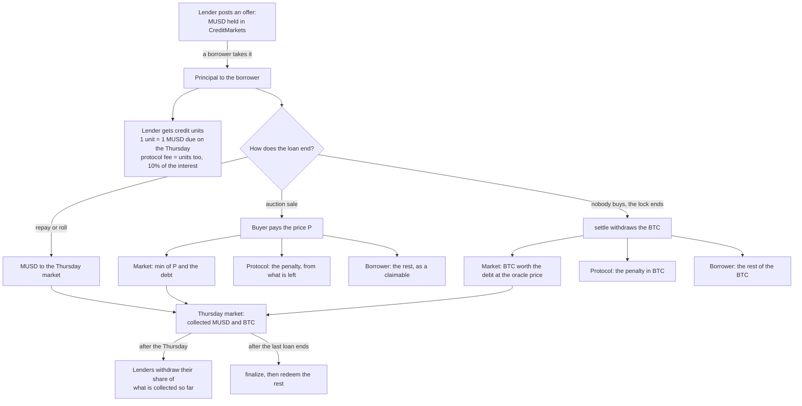

# Doji architecture

Doji lends MUSD against veBTC on Mezo at a fixed rate until a fixed Thursday. Two immutable contracts hold everything: `CreditMarkets` (lender offers and one market per Thursday, with ERC-1155 credit units) and `LoanManager` (custody of veBTC positions, loans, auctions and settlement). A keeper script on GitHub Actions calls the same public functions anyone can call. The website reads the chain directly; there is no backend and no database.

## 1. How the pieces connect

## 2. A loan's life

Every ending reduces its Thursday market's open-loan count by exactly one. When the Thursday has passed and that count is zero, anyone can call `finalize` and the market's lenders can redeem.

## 3. Where the money goes

Each Thursday is its own market, so a loss on one date never touches another. Inside a date, every unit (lenders' and the protocol's) shares collections pro rata.

## 4. Contracts and addresses

Mezo testnet (chain 31611), all verified on the explorer:

| Contract | Address |
|---|---|
| LoanManager | [0x983F2cD6e30492962104fc4dde8dbb5bd9d05Cfa](https://explorer.test.mezo.org/address/0x983F2cD6e30492962104fc4dde8dbb5bd9d05Cfa) |
| CreditMarkets | [0x62cBa75f2fAA834ddCa4bF012258368D17Bbb2de](https://explorer.test.mezo.org/address/0x62cBa75f2fAA834ddCa4bF012258368D17Bbb2de) |
| PassThrough (library) | [0x2E2430AB8Abbcbe89219dbB6D09265E10A5d2061](https://explorer.test.mezo.org/address/0x2E2430AB8Abbcbe89219dbB6D09265E10A5d2061) |

Mezo contracts Doji calls on testnet: veBTC `0xB63fcCd03521Cf21907627bd7fA465C129479231`, PoolsVoter `0x72F8dd7F44fFa19E45955aa20A5486E8EB255738`, fee distributor `0x10B0E7b3411F4A38ca2F6BB697aA28D607924729`, MUSD PriceFeed `0x86bCF0841622a5dAC14A313a15f96A95421b9366`, MUSD `0x118917a40FAF1CD7a13dB0Ef56C86De7973Ac503`, BTC ERC-20 `0x7b7C000000000000000000000000000000000000`. The full record, with the library's code hash, is `packages/contracts/deployments/31611.json`.

## 5. What the website reads and writes

The app (`packages/web`) talks to the chain through wagmi and viem, reads addresses from a book keyed by chain id (generated from `packages/contracts/deployments/31611.json`) and simulates every write before the wallet sees it. Every sent transaction is confirmed from the RPC and Mezo's explorer together.

| Screen | Reads | Writes |
|---|---|---|
| Landing | veBTC `supply` and PriceFeed `fetchPrice` on Mezo mainnet; open offers (`nextOfferId`, `offerOf`), `marketOf` per Thursday, risk settings, open auctions, explorer verification | none |
| Borrow | offers, `quoteFill`, `fetchPrice`, risk settings, the wallet's veBTC (`balanceOf`, `ownerToNFTokenIdList`, `escrowType`, `grantManager`, `lockOf`) and positions Doji holds for it | BTC `approve`, `lockAndBorrow`; or veBTC `approve`, `deposit`, `borrow` |
| Lend | offers, `quoteFill`, the wallet's offers (OfferPosted logs), units per Thursday (`balanceOf`, `pendingUnits`, `claimOf`, `marketOf`) | MUSD `approve`, `postOffer`, `cancelOffer`, `claimUnits`, `safeTransferFrom`, `withdrawCollected`, `finalize`, `redeem` |
| My loans | positions from Deposited logs with `positionOf`, `loanOf`, `owedOf`, `collateralValue`, `lockOf`, `isUnsafe`, `isOverdue`, veBTC `voted`, fee distributor `claimable`, `claimableMusd`, `claimableBtc` | MUSD `approve`, `repay`, `roll`, `withdrawCollateral`, `claim` |
| Loan page | the same for any id, plus `auctionOf` and `auctionPrice` | `purchase`, `startAuction`, `cancelAuction`, `prepareSettle`, `settle` |
| Try to break it | live targets | none: twelve simulated calls that the contracts refuse |

## 6. Rules the code keeps

The full standard is `docs/security/threat-model.md`: 29 invariants (custody, valuation, resolution, credit markets, funds, governance), each pointing to the code that keeps it, and the non-goals. The independent review and its fixes are in `docs/audit/findings-2026-10-20.md`; the live proofs are in `docs/proof/`.
