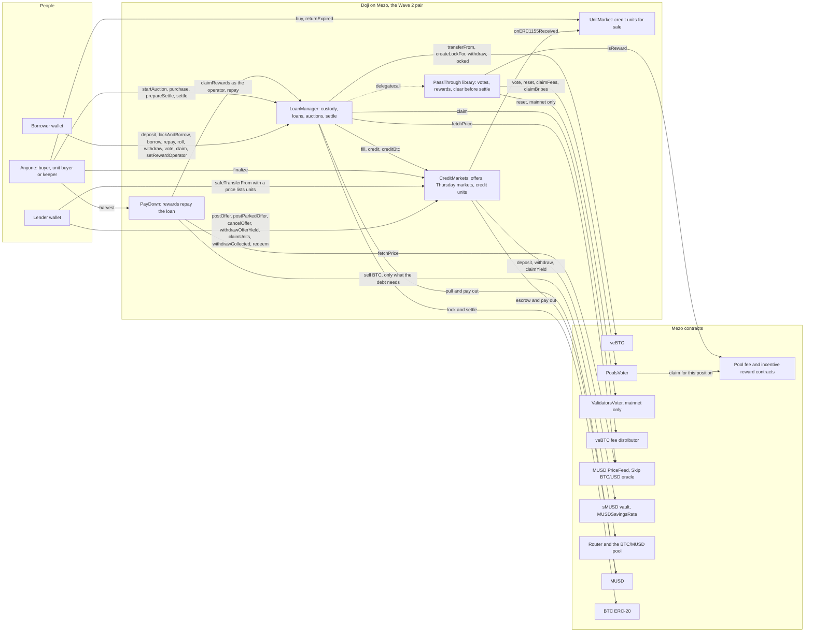
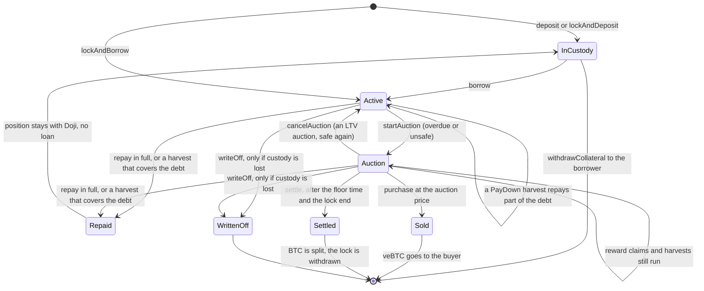
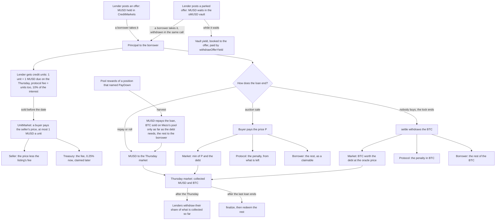

# Doji architecture

Doji lends MUSD against veBTC on Mezo at a fixed rate until a fixed Thursday. Each deployment is a pair of immutable contracts: `CreditMarkets` (lender offers and one market per Thursday, with ERC-1155 credit units) and `LoanManager` (custody of veBTC positions, loans, auctions and settlement). The Wave 2 pair, deployed on 4 November 2026, adds two more: `PayDown` (a position's pool rewards repay its loan) and `UnitMarket` (credit units for sale before their date), and its CreditMarkets can park an offer's waiting MUSD in Mezo's sMUSD vault. New offers and new loans go to the Wave 2 pair; the 20 October pair keeps serving every loan, offer, unit and auction opened on it. A keeper script on GitHub Actions calls the same public functions anyone can call, for both pairs. The website reads the chain directly; there is no backend and no database.

## 1. How the pieces connect

The 20 October pair has the same LoanManager, CreditMarkets and PassThrough without the Wave 2 parts: no PayDown, no UnitMarket, no sMUSD vault and no reward operator, and its reward claims accept only PoolsVoter's whitelisted tokens. ValidatorsVoter exists only on Mezo mainnet: both testnet records hold the zero address for it, so on testnet Doji passes votes to PoolsVoter only.

## 2. A loan's life

Every ending reduces its Thursday market's open-loan count by exactly one. When the Thursday has passed and that count is zero, anyone can call `finalize` and the market's lenders can redeem. A harvest changes a loan only by repaying it: as the reward operator, PayDown can call `claimRewards` for that position and nothing else (C36, C41).

## 3. Where the money goes

Each Thursday is its own market, so a loss on one date never touches another. Inside a date, every unit (lenders' and the protocol's) shares collections pro rata. Vault yield never enters a market or an offer's escrow, and it is paid only out of yield the vault actually delivered (C31). A unit sold on UnitMarket carries its whole claim on the date to the buyer.

## 4. Contracts and addresses

Mezo testnet (chain 31611), every Doji contract verified on the explorer, none upgradeable.

| Contract | Wave 2 pair (4 Nov 2026, block 16,564,749) | 20 October pair (block 16,259,280) |
|---|---|---|
| LoanManager | [0xdB407A06E5CedF2fd4f8C5C557338908B2776978](https://explorer.test.mezo.org/address/0xdB407A06E5CedF2fd4f8C5C557338908B2776978) | [0x983F2cD6e30492962104fc4dde8dbb5bd9d05Cfa](https://explorer.test.mezo.org/address/0x983F2cD6e30492962104fc4dde8dbb5bd9d05Cfa) |
| CreditMarkets | [0x89Dc7C4a7Cbfddf3Cb7a00b5f3fEFaB47aC61a1f](https://explorer.test.mezo.org/address/0x89Dc7C4a7Cbfddf3Cb7a00b5f3fEFaB47aC61a1f) | [0x62cBa75f2fAA834ddCa4bF012258368D17Bbb2de](https://explorer.test.mezo.org/address/0x62cBa75f2fAA834ddCa4bF012258368D17Bbb2de) |
| PassThrough (library) | [0x895187e9501E424774d93A0931D36b4be99E58A9](https://explorer.test.mezo.org/address/0x895187e9501E424774d93A0931D36b4be99E58A9) | [0x2E2430AB8Abbcbe89219dbB6D09265E10A5d2061](https://explorer.test.mezo.org/address/0x2E2430AB8Abbcbe89219dbB6D09265E10A5d2061) |
| PayDown | [0xf0dbbD5167F9852234883aD58109dC80692a18DE](https://explorer.test.mezo.org/address/0xf0dbbD5167F9852234883aD58109dC80692a18DE) | none |
| UnitMarket | [0xC50ff38f0a51Cda01BFB2c7E6324c30Cf5a16e18](https://explorer.test.mezo.org/address/0xC50ff38f0a51Cda01BFB2c7E6324c30Cf5a16e18) | none |

Mezo contracts Doji calls on testnet: veBTC `0xB63fcCd03521Cf21907627bd7fA465C129479231`, PoolsVoter `0x72F8dd7F44fFa19E45955aa20A5486E8EB255738`, fee distributor `0x10B0E7b3411F4A38ca2F6BB697aA28D607924729`, MUSD PriceFeed `0x86bCF0841622a5dAC14A313a15f96A95421b9366`, MUSD `0x118917a40FAF1CD7a13dB0Ef56C86De7973Ac503`, BTC ERC-20 `0x7b7C000000000000000000000000000000000000`, and for the Wave 2 pair only the sMUSD vault (MUSDSavingsRate) `0x6f461c68B2c5492C0F5CCEc5a264d692aA7A8e16` and the Router `0x9a1ff7FE3a0F69959A3fBa1F1e5ee18e1A9CD7E9` with its default pool factory `0x4947243CC818b627A5D06d14C4eCe7398A23Ce1A`. ValidatorsVoter is Mezo mainnet only: both testnet records hold the zero address for it, so on testnet Doji passes votes to PoolsVoter only. The full records, with each library's code hash, are `packages/contracts/deployments/31611-wave2.json` and `packages/contracts/deployments/31611.json`.

How the Wave 2 contracts depend on each other:

- LoanManager and CreditMarkets fix each other's address in their constructors and never point at the 20 October pair (C27).
- CreditMarkets fixes the sMUSD vault at deployment. It approves the vault for exactly the amount it deposits and resets the approval to zero, and it judges every vault call by the measured change in its own balances (C30, C34).
- PayDown fixes LoanManager, the Router and its factory, and reads MUSD, BTC and the PriceFeed from LoanManager at deployment (C42). LoanManager knows nothing about PayDown: PayDown is just an address a borrower may name as the reward operator (C36, C37).
- UnitMarket fixes the Wave 2 CreditMarkets and reads MUSD from it. It accepts units from that contract alone, so 20 October units cannot be listed (C43).

## 5. What the website reads and writes

The app (`packages/web`) talks to the chain through wagmi and viem, reads addresses from a book keyed by chain id, generated from the deployment records of both pairs, and simulates every write before the wallet sees it. Every sent transaction is confirmed from the RPC and Mezo's explorer together. New offers and new loans are built only on the Wave 2 pair. Everything a user already has (offers, loans, units, claims, auctions, loan pages) is read from both pairs, each item tagged with its pair, and written back to the pair that holds it. Nothing is identified by a maturity or a token id alone (C49).

| Screen | Reads | Writes |
|---|---|---|
| Landing | veBTC `supply` and PriceFeed `fetchPrice` on Mezo mainnet; open offers (`nextOfferId`, `offerOf`), `marketOf` per Thursday, risk settings, open auctions, explorer verification | none |
| Borrow | offers, `quoteFill`, `fetchPrice`, risk settings, the wallet's veBTC (`balanceOf`, `ownerToNFTokenIdList`, `escrowType`, `grantManager`, `lockOf`) and positions Doji holds for it | BTC `approve`, `lockAndBorrow`; or veBTC `approve`, `deposit`, `borrow` |
| Lend | offers, `quoteFill`, the wallet's offers (OfferPosted logs, each kept only if `offerOf` names the wallet as maker), units per Thursday (`balanceOf`, `pendingUnits`, `claimOf`, `marketOf`) | MUSD `approve`, `postOffer`, `cancelOffer`, `claimUnits`, `safeTransferFrom`, `withdrawCollected`, `finalize`, `redeem` |
| My loans | positions from Deposited logs with `positionOf`, `loanOf`, `owedOf`, `collateralValue`, `lockOf`, `isUnsafe`, `isOverdue`, veBTC `voted`, fee distributor `claimable`, `claimableMusd`, `claimableBtc` | MUSD `approve`, `repay`, `roll`, `extendLock`, `vote`, `resetVotes`, `claimRewards`, `claimRebase`, `withdrawCollateral`, `claim` |
| Loan page | the same for any id, plus `auctionOf` and `auctionPrice` | MUSD `approve` and `purchase`, `startAuction`, `cancelAuction`, `prepareSettle`, `settle`; for the loan's borrower, the My loans writes |
| Try to break it | live targets | none: twelve simulated calls that the contracts refuse |

The Wave 2 parts of those screens, under rules C49 and C50:

| Screen | Reads | Writes |
|---|---|---|
| Lend: "Earn in sMUSD while it waits" | `parkingOn`; for each parked offer `offerOf` (its `parked` flag), `isInVault` and `pendingOfferYield`; the wallet's `yieldOwedOf` | `postParkedOffer` instead of `postOffer` when the switch is on; `withdrawOfferYield` |
| Lend: "Credit units for sale" | UnitMarket `Listed` events, each listing re-read with `listingOf`; `quoteBuy` for the exact cost | listing by CreditMarkets `safeTransferFrom` to UnitMarket with `abi.encode(uint128 pricePerUnit, uint64 expiry)`; MUSD `approve` for exactly the quoted cost, then `buy`; `cancel`; `returnExpired` |
| My loans and the loan page: pay-down | `positionOf` (its `rewardOperator`); PayDown `Harvested` events for the position, re-read from the chain | `setRewardOperator(tokenId, PayDown)` to opt in, `setRewardOperator(tokenId, 0)` to stop |

The pay-down switch only ever names the PayDown in the address book, and a position whose operator is any other address shows a warning (C50).

## 6. Rules the code keeps

The full standard is `docs/security/threat-model.md`: 53 invariants, each pointing to the code that keeps it, and the non-goals. C1 to C29 cover custody, valuation, resolution, credit markets, funds and governance; C30 to C53 cover Wave 2: parked offers, the reward operator, PayDown, UnitMarket, and the keeper and website across two pairs. The independent reviews and their fixes are in `docs/audit/findings-2026-10-20.md` and `docs/audit/findings-2026-11-04.md`, static analysis of the Wave 2 code is in `docs/security/slither-2026-11-04.md`, and the live proofs are in `docs/proof/`.
