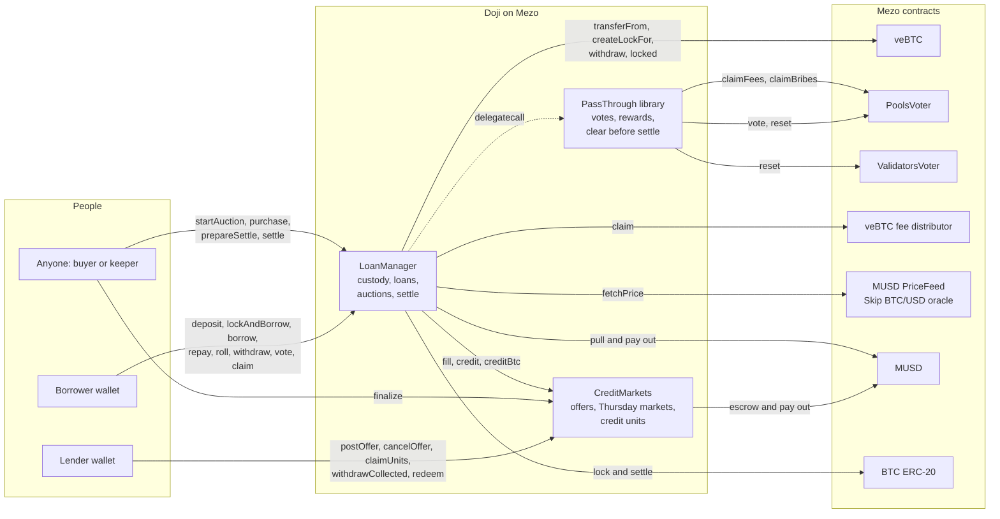
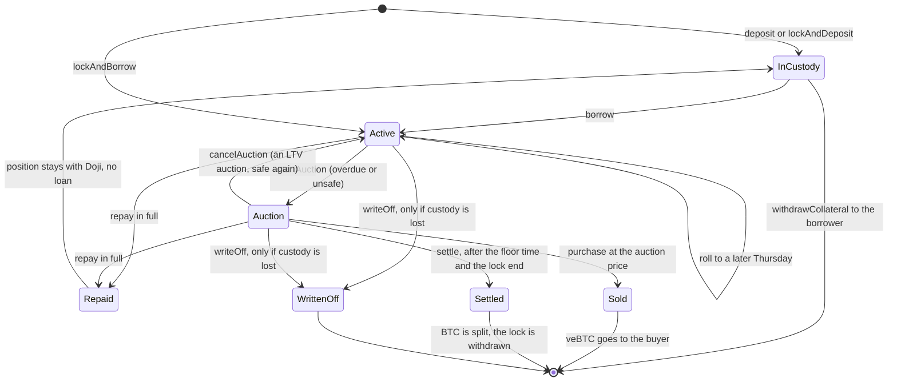
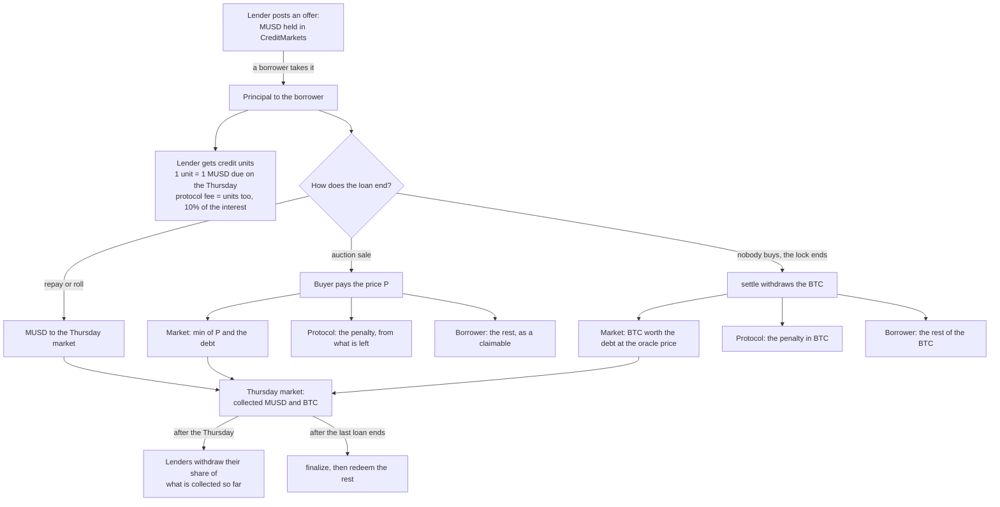

<p align="center">
  
</p>

<h1 align="center">Doji</h1>

Dōji (同時) means "at the same time": your Bitcoin stays locked and earning while you borrow against it.

Borrow MUSD against the Bitcoin you have locked on Mezo, at a fixed rate until a fixed date, without ending the lock or losing the rewards.

[Live app](https://dojis.site) · [Demo video](https://youtu.be/rLvW37wmeaY) · [Docs](https://dojis.site/docs) · [Try to break it](https://dojis.site/break) · [Architecture](ARCHITECTURE.md)

## Live deployments

| Network | Chain ID | Contracts | Deployed |
| --- | --- | --- | --- |
| Mezo testnet | 31611 | [LoanManager](https://explorer.test.mezo.org/address/0x983F2cD6e30492962104fc4dde8dbb5bd9d05Cfa), [CreditMarkets](https://explorer.test.mezo.org/address/0x62cBa75f2fAA834ddCa4bF012258368D17Bbb2de), [PassThrough](https://explorer.test.mezo.org/address/0x2E2430AB8Abbcbe89219dbB6D09265E10A5d2061) | 2026-10-20, block 16,259,280 |

All three are verified on Mezo's testnet explorer and none can be upgraded. Test BTC and test MUSD have no value. The app runs at [dojis.site](https://dojis.site) and reads Mezo straight from the browser, with no server of its own.

## Overview

Mezo rewards people who keep Bitcoin locked as veBTC: a share of chain fees, a vote on where emissions go, and incentives for that vote. Until now that Bitcoin could not back a loan. Mezo's own FAQ asks "Can I use my locked BTC as collateral?" and answers "No." ([Mezo veBTC FAQ](https://mezo.org/docs/users/mezo-earn/lock/vebtc/faqs-and-resources)).

Doji makes it yes. A borrower hands Doji a veBTC position, or locks BTC and borrows in one step, picks a Thursday and takes lenders' fixed-rate offers. The MUSD arrives at once and the amount owed on that date is fixed. While the loan runs, the lock keeps running and the votes and rewards stay with the borrower.

In August 2026 Mezo described the credit market Bitcoin lending needs ([How to Build a Bitcoin-Backed Credit Market](https://mezo.org/blog/how-to-build-a-bitcoin-backed-credit-market/)): the repayment is known in advance, lenders choose their date and post offers that wait until a borrower takes them, and the lender's claim is a unit that can change hands. Doji is that market for veBTC and MUSD, live on Mezo testnet today.

Doji is for veBTC holders who need MUSD and do not want to end their lock, and for MUSD holders who want a fixed return to a known date, backed by locked Bitcoin.

| | Without Doji | With Doji |
| --- | --- | --- |
| Borrowing against veBTC | Not possible. A locked position cannot back an MUSD loan. | Hand Doji the position, or lock BTC and borrow in one step. |
| Votes and rewards while borrowing | To use the BTC you wait for the lock to end and withdraw it, and the position's votes and rewards end with it. | The lock keeps running. Votes, pool rewards and chain fees stay with you. |
| A fixed rate | Mezo's MUSD loans take BTC that is not locked, at a rate set by Mezo governance. | Lenders post fixed rates, the cheapest are taken first, and the amount you owe is shown before you sign. |
| A fixed date | An MUSD loan stays open until repaid. | Every loan is due on a Thursday you pick, up to 4 weeks out, and can roll to a later one. |
| What lenders get | A variable return: the sMUSD savings vault, or liquidation BTC in the Stability Pool. | A fixed rate to a known Thursday, as credit units they can send, with payouts from the date on. |
| What happens in a crash | An MUSD loan under 110% collateral is liquidated, and a funded Stability Pool takes the BTC. | A protected auction starts at the full value. The borrower keeps everything left after the debt and the protocol's 5% penalty. If nobody buys, the lenders take the Bitcoin itself. |

## Features

### For borrowers

- Lock BTC and borrow in one transaction, or hand Doji a veBTC position you already hold. Only that one position is ever approved.
- Pick a Thursday and an amount. The screen shows what you receive now, what you owe on the date, the rate, how much of the 40% limit you use, and the BTC price at which the loan would reach its auction line.
- Repay any time, in part or in full. Repaying early still costs the full amount, which is what makes the lender's return fixed.
- Roll to a later Thursday in one transaction. When the new date is past the lock's end, Roll extends the lock first.
- Vote, reset votes, extend the lock, claim the veBTC rebase and claim pool fees and incentives from My loans and the loan page. On testnet the two claims cannot succeed for reasons on Mezo's side: the testnet PoolsVoter whitelists no reward token and the testnet fee distributor reverts `UpdatePeriod`. The same calls are proven on Mezo mainnet forks.
- Withdraw the veBTC position once nothing is owed.

### For lenders

- Post an offer: an amount, a Thursday and a fixed rate. The MUSD waits in the contract, and whatever is not taken can be cancelled at any time. No pause can block a cancel.
- Receive credit units for the date: 1 unit is 1 MUSD due on that Thursday. Units are ERC-1155 tokens you can send.
- From the Thursday on, withdraw your share of what has been collected, and the rest as it arrives. One unpaid loan delays only its own share.
- Close a date once its last loan ends and redeem. Each Thursday is its own market, so a bad loan in one week never touches another.

### When a loan goes wrong

- A loan that is overdue, or whose debt rises above 65% of its value, goes to a falling-price auction that starts at the full value and falls to 70% of it over 72 hours.
- The price never falls below the debt while the Bitcoin covers it, and every purchase reprices at a fresh value, so a rebound raises the price for the borrower.
- Lenders are paid first, the protocol takes a penalty of 5% of the debt out of whatever the sale raised above the debt, and the borrower keeps the rest.
- If nobody buys, the lock is withdrawn when it ends and the lenders receive the Bitcoin itself at the oracle price. Doji never sells on a DEX.
- Every loan ends within a published time after its date: the auction, one epoch for a vote reset, and the longest lock the position can carry.

### For anyone

- Start an auction, cancel a recovered one, buy, prepare and settle, write off a position that left custody, and close a date. None of these needs a role, and the contracts check every condition.
- A keeper on GitHub Actions makes those calls. It is scheduled every 30 minutes, but GitHub starts scheduled jobs late on a quiet repository: from 19 to 22 October 2026 a pass ran every 2.3 to 5.9 hours. A pass can also be started by hand, and anyone can run the same script.
- Every loan has a public page. Try to break it runs twelve attacks against the live contracts and shows how each is refused.

## Testnet deployment

| Contract | Address on Mezo testnet (31611) | Role |
| --- | --- | --- |
| LoanManager | [0x983F2cD6e30492962104fc4dde8dbb5bd9d05Cfa](https://explorer.test.mezo.org/address/0x983F2cD6e30492962104fc4dde8dbb5bd9d05Cfa) | Doji: custody, loans, auctions, settle. Verified. |
| CreditMarkets | [0x62cBa75f2fAA834ddCa4bF012258368D17Bbb2de](https://explorer.test.mezo.org/address/0x62cBa75f2fAA834ddCa4bF012258368D17Bbb2de) | Doji: offers, Thursday markets, credit units. Verified. |
| PassThrough (library) | [0x2E2430AB8Abbcbe89219dbB6D09265E10A5d2061](https://explorer.test.mezo.org/address/0x2E2430AB8Abbcbe89219dbB6D09265E10A5d2061) | Doji: the borrower's votes and reward claims. Verified. |
| veBTC | [0xB63fcCd03521Cf21907627bd7fA465C129479231](https://explorer.test.mezo.org/address/0xB63fcCd03521Cf21907627bd7fA465C129479231) | Mezo: the collateral. |
| PoolsVoter | [0x72F8dd7F44fFa19E45955aa20A5486E8EB255738](https://explorer.test.mezo.org/address/0x72F8dd7F44fFa19E45955aa20A5486E8EB255738) | Mezo: votes and pool rewards. |
| veBTC fee distributor | [0x10B0E7b3411F4A38ca2F6BB697aA28D607924729](https://explorer.test.mezo.org/address/0x10B0E7b3411F4A38ca2F6BB697aA28D607924729) | Mezo: chain fees for veBTC. |
| MUSD | [0x118917a40FAF1CD7a13dB0Ef56C86De7973Ac503](https://explorer.test.mezo.org/address/0x118917a40FAF1CD7a13dB0Ef56C86De7973Ac503) | Mezo: the loan currency. |
| MUSD PriceFeed | [0x86bCF0841622a5dAC14A313a15f96A95421b9366](https://explorer.test.mezo.org/address/0x86bCF0841622a5dAC14A313a15f96A95421b9366) | Mezo: the BTC price from the Skip oracle. |
| BTC ERC-20 | [0x7b7C000000000000000000000000000000000000](https://explorer.test.mezo.org/address/0x7b7C000000000000000000000000000000000000) | Mezo: the BTC that veBTC locks and pays in. |

PassThrough runtime code hash: `0x37e8ef36bdb592b8cbb39af72ce99b46ce3098ff8b706bda489ab7e3737b72b6`. The deploy script refuses a library whose code differs from the compiled one. The full record is [packages/contracts/deployments/31611.json](packages/contracts/deployments/31611.json), and every Mezo contract and call, with mainnet addresses, is in the [Built on Mezo](https://dojis.site/docs/mezo) docs page.

## Architecture

### 1. How the pieces connect



### 2. A loan's life



### 3. Where the money goes



## Try it in two minutes

No wallet is needed to follow this path, and nothing in it spends anything.

1. Open [the live app](https://dojis.site). The first screen says what Doji does and shows live numbers: Bitcoin locked as veBTC on Mezo, MUSD on offer in Doji, the best fixed rate and the latest block.
2. Scroll once. Mezo's FAQ asks "Can I use my locked BTC as collateral?" and answers "No." The seal stamps "Yes. At the same time." beside a real open loan whose lock, votes and rewards are read live.
3. Click "Borrow MUSD". The offers by date and rate are there before any wallet. Type a BTC amount and an MUSD amount to see exactly what you would owe on that Thursday; borrowing for real needs a wallet and test BTC from the [faucet](https://faucet.test.mezo.org).
4. Click "Lend" in the top bar: dates, best rates, and an offer summary with the protocol's 10% share of the interest.
5. Open [an example loan's page](https://dojis.site/loans/389): its owed amount, collateral, auction line, lock, votes, rewards and its own terms. A loan in auction shows the live price and a Buy button; the landing page's auction chart links to any open one. Two example loans, [405](https://dojis.site/loans/405) and [406](https://dojis.site/loans/406), fall due on Thursday 29 October 2026 and were left unpaid on purpose, so from that day anyone holding test MUSD can try buying one.
6. Click "Try to break it" in the top bar, then "Run all". Twelve attacks are simulated against the live contracts, and each card shows the contract's refusal and the block it ran on.
7. Open [Check it yourself](https://dojis.site/docs/proof) in the docs: every claim mapped to a screen, a file and a transaction.

Then prove the main promise on the live network yourself. It needs bash, Python 3, Foundry and one testnet wallet of your own:

1. Run `cast wallet new` to get a fresh address and private key.
2. Run `cp packages/contracts/.env.example packages/contracts/.env` and set only `BORROWER_PRIVATE_KEY` and `BORROWER_ADDRESS` to that wallet. The other wallets in the file belong to the deploy and seed scripts.
3. Claim test BTC for that address from the [Mezo faucet](https://faucet.test.mezo.org), which has a CAPTCHA. The run needs at least 0.0008 test BTC.
4. Get a few cents of test MUSD for the interest. The faucet gives only BTC, so borrow 10 MUSD on [Borrow](https://dojis.site/borrow) with the same wallet, or swap BTC for MUSD in Mezo's testnet app at [testnet.mezo.org](https://testnet.mezo.org). The script checks both balances before it sends anything.

More detail is in [Run the proof yourself](https://dojis.site/docs/developers/run-the-proof).

```bash
bash packages/contracts/script/prove-it.sh
```

It locks test BTC, borrows 10 MUSD at a fixed rate, checks the loan on chain, attacks it as a stranger, repays and takes the position back. The [23 October 2026 run](docs/proof/prove-it-2026-10-23.md) ended with (the [20 October run](docs/proof/prove-it-2026-10-20.md) did too):

```text
Doji promise proven: 8 of 8 checks passed
```

## Quick start for developers

```bash
git clone https://github.com/ramakrishnanhulk20/doji.git
cd doji
git submodule update --init
```

The submodule step fetches forge-std and OpenZeppelin Contracts into `packages/contracts/lib`. `forge install` with no arguments does the same.

Contracts (needs [Foundry](https://book.getfoundry.sh) 1.8 or newer; the full `forge test` takes 2 to 3 minutes and prints its summary at the end):

```bash
cd packages/contracts
forge build
forge test                            # everything, including the Mezo mainnet fork suites
forge test --match-path "test/fork/*" -vv
```

The fork tests use the public RPCs named in `foundry.toml`: `https://mezo.drpc.org` for Mezo mainnet and `https://rpc.test.mezo.org` for testnet. They need no key. When a public node is overloaded, a fork test fails with an HTTP error such as 504, not a revert. `forge test --no-match-path "test/fork/*"` runs the 298 tests that need no network, and pointing `mezo_mainnet` in `foundry.toml` at another of Mezo's public RPCs, such as `https://mezo-mainnet.boar.network`, runs the fork suites again.

Web app (needs Node 20.12 or newer):

```bash
cd packages/web
npm ci
npm run dev                           # http://localhost:3001
```

The app reads the chain directly and needs no environment variables. It takes its addresses from the deployment records in `packages/contracts/deployments`.

Keeper:

```bash
cd packages/keeper
npm ci
npm run keeper:dry                    # one pass that only simulates; needs no key and sends nothing
```

## Contracts

The full NatSpec, with every custom error, is in [ILoanManager.sol](packages/contracts/src/interfaces/ILoanManager.sol) and [ICreditMarkets.sol](packages/contracts/src/interfaces/ICreditMarkets.sol).

### LoanManager

| Function | Who may call | What it does |
| --- | --- | --- |
| `deposit(tokenId)` | the position's owner | Pulls a veBTC position after a single-token approval and records the caller as its borrower. |
| `lockAndDeposit(amount, lockDuration)` | anyone | Locks the caller's BTC as a new veBTC position minted straight to LoanManager. Pausable. |
| `lockAndBorrow(amount, lockDuration, maturity, offerIds, amounts, maxAprBps)` | anyone | Locks and borrows in one transaction. Pausable. |
| `borrow(tokenId, maturity, offerIds, amounts, maxAprBps)` | the borrower | Borrows MUSD from the listed offers against a held position with no open loan. Pausable. |
| `repay(tokenId, amount)` | anyone | Pays down a loan, at most what is owed. The last payment closes it and any auction. Never paused. |
| `roll(tokenId, newMaturity, offerIds, amounts, maxAprBps, maxTopUp)` | the borrower | Moves an active, on-time loan to a later Thursday and repays the old date in full. Pays nothing out while borrows are paused. |
| `withdrawCollateral(tokenId)` | the borrower | Sends a position with no open loan back to its borrower. |
| `vote(tokenId, pools, weights)` | the borrower | Casts the position's PoolsVoter vote. The loan must be on time and safe; no vote in a normal lock's last week. |
| `resetVotes(tokenId)` | the borrower | Clears the position's PoolsVoter vote. |
| `claimRewards(tokenId, gauges, feeTokens, bribeTokens)` | the borrower | Claims pool fees and incentives from registered gauges and pays the measured increase to the borrower. |
| `claimRebase(tokenId)` | the borrower | Claims from the veBTC fee distributor. BTC from an expired lock is credited to the borrower. |
| `extendLock(tokenId, lockDuration)` | the borrower | Pushes the lock's end out. The loan must be on time and safe. |
| `startAuction(tokenId)` | anyone | Starts the auction of an overdue or unsafe loan and snapshots its curve. |
| `cancelAuction(tokenId)` | anyone | Returns an LTV auction's loan to Active once a fresh price shows it safe. |
| `purchase(tokenId, maxPay, deadline)` | anyone | Buys an auctioned position at the current price and splits the payment. |
| `prepareSettle(tokenId)` | anyone | Resets live votes and makes a permanent lock normal on an unsold position past its floor time. |
| `settle(tokenId)` | anyone | Withdraws an unsold position's ended lock and splits the BTC. |
| `writeOff(tokenId)` | anyone | Closes a loan whose position has left custody, with zero recovery. |
| `claim()` | anyone with a claimable | Pays the caller its MUSD and BTC claimables. |
| `setRiskParams`, `setAuctionParams`, `setMinLoan`, `setGuardian` | owner | Settings for new loans, inside hard-coded bounds. |
| `setBorrowsPaused(paused)` | guardian or owner | Pauses new borrows, lock creation and a roll's cash-out. Nothing else. |
| `rescueToken(token, to, amount)`, `rescuePosition(tokenId, to)` | owner | Moves stray tokens above what claimants are owed, or a veBTC that never became a position. |
| `transferOwnership(newOwner)`, `acceptOwnership()` | owner, then the new owner | Two-step ownership transfer. `renounceOwnership()` always reverts. |
| `collateralValue`, `owedOf`, `positionOf`, `loanOf`, `auctionOf`, `auctionPrice`, `isOverdue`, `isUnsafe`, `lockOf`, `claimableMusd`, `claimableBtc` | anyone (views) | The value, debt, records, auction price, triggers, lock and claimables the site reads. |

### CreditMarkets

| Function | Who may call | What it does |
| --- | --- | --- |
| `postOffer(maturity, aprBps, amount)` | anyone | Escrows MUSD as a fixed-rate offer for a valid Thursday within the longest term. Pausable. |
| `cancelOffer(offerId)` | the offer's maker | Refunds the unfilled part. Never paused. |
| `claimUnits(maturity)` | anyone with units waiting | Mints the caller's recorded credit units. |
| `withdrawCollected(maturity, units)` | any holder, after the date | Moves units into a Claim and pays the share collected so far. |
| `finalize(maturity)` | anyone | Closes a date that has passed and has no open loans. |
| `redeem(maturity, units)` | any holder, after `finalize` | Burns units and pays their share of MUSD (at most 1 per unit) and BTC. |
| `safeTransferFrom`, `safeBatchTransferFrom`, `setApprovalForAll` | holders | Standard ERC-1155 transfers. |
| `fill(maturity, offerIds, amounts, maxAprBps, recipient)` | LoanManager only | Fills up to 8 offers for one loan and records the lenders' and the protocol's units. |
| `credit(maturity, musdAmount, closesLoan)`, `creditBtc(maturity, btcAmount, closesLoan)` | LoanManager only | Books MUSD or BTC into a date, measured as it arrives. |
| `setFeeShareBps`, `setMinOffer`, `setMaxTermSeconds`, `setTreasury`, `setGuardian`, `setURI` | owner | Settings for new offers and fills, inside hard-coded bounds. |
| `setOffersPaused(paused)` | guardian or owner | Pauses `postOffer` only. |
| `rescueToken(token, to, amount)` | owner | Moves a stray token that is neither MUSD nor BTC. |
| `transferOwnership(newOwner)`, `acceptOwnership()` | owner, then the new owner | Two-step ownership transfer. `renounceOwnership()` always reverts. |
| `quoteFill`, `offerOf`, `marketOf`, `pendingUnits`, `claimOf`, `paidOutOf`, `isValidMaturity`, `balanceOf` | anyone (views) | Quotes, offers, market totals, units and payouts the site reads. |

Every event, view and setting is listed in the [Contracts](https://dojis.site/docs/developers/contracts) docs page.

## Tests

The last full run, on 2026-10-25, including the 13 Mezo mainnet fork tests:

```text
Ran 19 test suites in 218.11s (751.29s CPU time): 311 tests passed, 0 failed, 0 skipped (311 total tests)
```

- Unit tests for the public functions, their reverts and their events. Each test file opens with what it does not cover.
- Fuzz tests at 1,000 runs each: units always equal the face, sale and settle splits always add up, early and late lenders get the same total per unit, and no sale pays the market below the smaller of the debt and the value at the time of sale.
- Invariant tests at 256 runs of depth 64: random sequences of posts, borrows, repays, rolls, auctions, settles, redemptions and early withdrawals across three dates, with the accounting rules checked after every call.
- Fork tests against real Mezo mainnet state: real veBTC positions, PoolsVoter and ValidatorsVoter, the fee distributor and MUSD, including a sale half way down the curve, a settle of a real lock, a vote cleared through the real voter, a roll, and real pool fees forwarded to the borrower.
- The four audit regression tests, written to fail on the code the review read.

Static analysis: slither on the deployed contracts (2026-10-21, dependencies excluded) found 38 results: 0 High, 9 Medium, 27 Low, 2 Informational. Each Medium was read and kept on purpose:

| Detector | Where | Why it stays |
| --- | --- | --- |
| incorrect-equality | `LoanManager._pullExact` | `amount == 0` skips an empty transfer. It is not a balance check. |
| incorrect-equality | `PassThrough._payGains` | `gained[i] == 0` skips an empty transfer, the same pattern. |
| reentrancy-no-eth | `LoanManager._openLoan` | The loan's face is only known after `CreditMarkets.fill` returns. CreditMarkets is fixed at deployment and both contracts hold reentrancy locks. |
| reentrancy-no-eth (2 results) | `CreditMarkets.withdrawCollected` | The flagged call is the burn of the lender's units. A burn goes to address zero, and OpenZeppelin's ERC-1155 calls a receiver only for a non-zero address, so nothing outside runs. The function also holds the reentrancy lock and transfers last. |
| unused-return | `LoanManager.prepareSettle` | The lock reader returns three fields and this path needs only one. |
| unused-return | `LoanManager.settle` | The same: only the fields settle needs are used. |
| unused-return | `LoanManager.claimRebase` | The distributor's own figure is ignored on purpose. What is credited is the BTC measured arriving. |
| unused-return | `PassThrough.castVote` | The lock reader's fields are taken only as the vote check needs them. |

The Lows are capped loops, calls to fixed Mezo contracts or the same unit burn under the reentrancy lock, week-scale timestamp comparisons, and two return names in `ICreditMarkets.paidOutOf` that repeat the token names.

The live website test drove the real site in a headless Chrome on Mezo testnet with a test wallet: 11 transactions across Borrow, My loans and Lend, each checked on chain through the RPC and the explorer ([docs/proof/ui-live-2026-10-20.md](docs/proof/ui-live-2026-10-20.md)). On 22 and 23 October two example loans, left unpaid on purpose, went to auction, one was bought through its loan page for 74.42 MUSD (lenders 28.51, protocol 1.43, borrower 44.49), the lender withdrew its 28.51 MUSD before the date closed, and example loan 389 rolled to 12 November with its votes still in place ([docs/proof/auction-and-early-payout-2026-10-23.md](docs/proof/auction-and-early-payout-2026-10-23.md)).

## Gas

From the testnet seed run in [31611-demo.json](packages/contracts/deployments/31611-demo.json):

- Lock BTC and borrow in one transaction: about 0.66M to 0.71M gas.
- Post an offer: about 0.1M gas (99,473 to 121,361).
- Approve a token: about 26,000 to 46,000 gas.

At the 172 wei per gas testnet charged on 2026-10-19, a lock and borrow costs about 0.00000000012 test BTC and posting an offer about 0.00000000002. The keeper's calls run from about 71,000 gas (`cancelAuction`) to 614,000 (`settle`); see the [keeper README](packages/keeper/README.md).

## Project structure

```text
packages/contracts    Solidity contracts, tests (unit, fuzz, invariant, fork, audit), deploy, seed and prove-it scripts, deployment records
packages/web          the Next.js app, with the docs in content/docs
packages/keeper       the keeper script
docs                  threat model, risk study, audit findings, live proofs
analysis              the Bitcoin drawdown study and its data
.github/workflows     the keeper's schedule on GitHub Actions
```

## Tech stack

| Part | Built with |
| --- | --- |
| Contracts | Solidity 0.8.28 (EVM cancun), Foundry, OpenZeppelin Contracts 5.7 |
| App | Next.js 16, React 19, Tailwind CSS 4, wagmi 3.7, viem 2.57, TanStack Query 5 |
| Motion | GSAP 3.15, Lenis 1.3, Motion 14 |
| Docs | Fumadocs 16 inside the app, Mermaid 12 |
| Keeper | TypeScript on Node, viem 2.57, run by GitHub Actions |
| Chain | Mezo testnet (31611); Mezo mainnet (31612) for fork tests |

## Security

Custody comes first. Doji holds other people's veBTC positions, and on 5 October 2026 an attacker moved 37 veBTC positions on Mezo mainnet through a trusted-forwarder (meta-transaction) flaw ([Mezo's incident report](https://mezo.org/blog/incident-report-october-5-2026)). Doji has no meta-transaction or forwarder path at all.

- The threat model was written before any contract code. Its 29 rules are the definition of done, each kept by named code and tested: [docs/security/threat-model.md](docs/security/threat-model.md).
- An independent review pass on 2026-10-20, separate from the build and not a third-party audit firm, found no Critical or High issue, one Medium and three Low. Each was fixed with tests that failed before the fix, and the fixed contracts are the ones deployed: [docs/audit/findings-2026-10-20.md](docs/audit/findings-2026-10-20.md).
- Non-goals, stated openly: a flaw or upgrade in Mezo's own contracts, an oracle outage, Bitcoin price moves after a settle, losses shared across one date, and an exit before the date (units can be sent, but Doji provides no buyer).
- To report a problem, open an issue at [github.com/ramakrishnanhulk20/doji/issues](https://github.com/ramakrishnanhulk20/doji/issues).

The risk limits come from Bitcoin's daily prices since August 2017: [docs/risk/parameters.md](docs/risk/parameters.md).

## Licence

MIT. See [LICENSE](LICENSE).

## Acknowledgments

- [Mezo](https://mezo.org), for veBTC, PoolsVoter, MUSD, the MUSD price feed, the testnet faucet and the explorer.
- The Supernormal Foundation and AKINDO, for the Mezo Buildathon.
- [OpenZeppelin Contracts](https://github.com/OpenZeppelin/openzeppelin-contracts), [Foundry](https://github.com/foundry-rs/foundry) and [Fumadocs](https://fumadocs.dev).
- [Dōjima Rice Exchange, Yoshimitsu Sasaki, c. 1880. Osaka Prefectural Nakanoshima Library. Public domain, via Wikimedia Commons.](https://commons.wikimedia.org/wiki/File:Dojima-Rice-Exchange-Osaka-by-Yoshimitsu-Sasaki.png)
