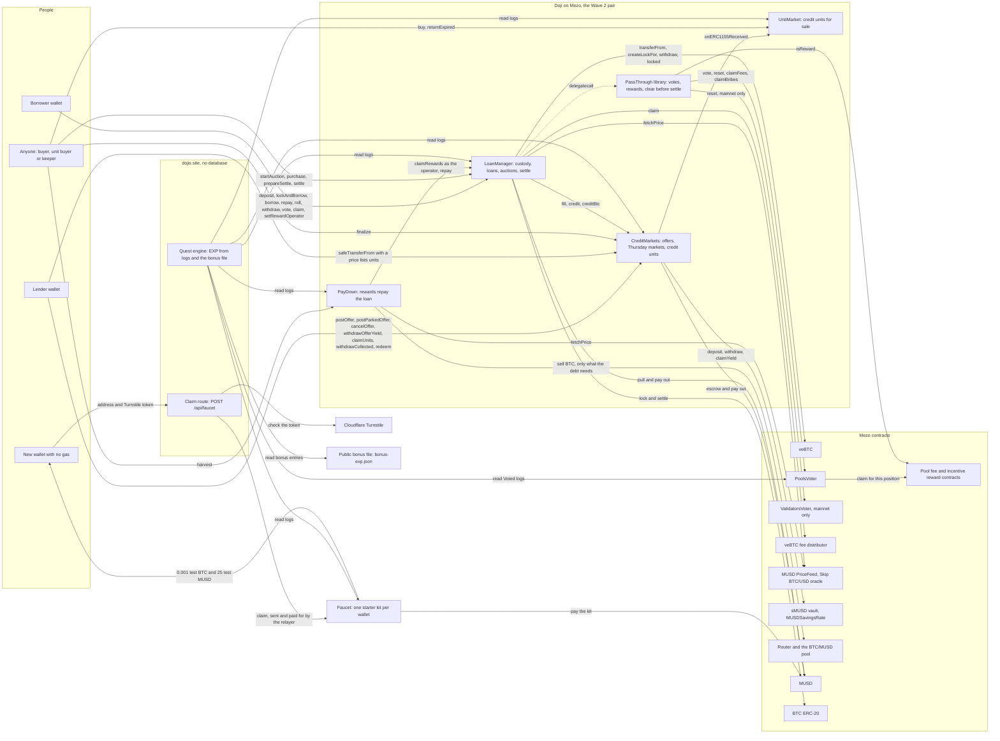
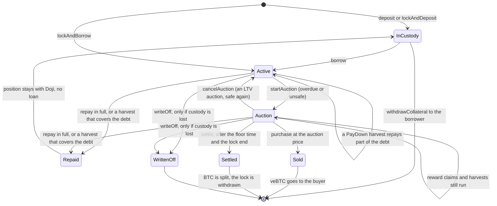
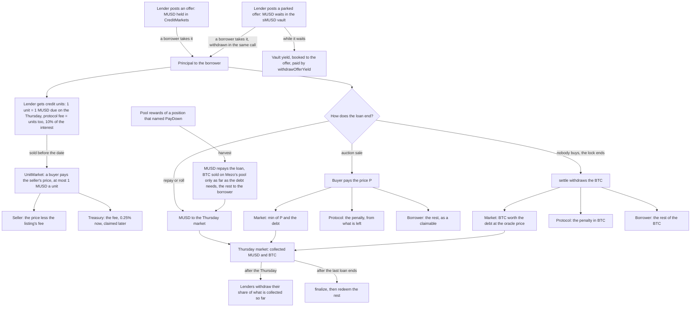

<p align="center">
  
</p>

<h1 align="center">Doji</h1>

Dōji (同時) means "at the same time": your Bitcoin stays locked and earning while you borrow against it.

Borrow MUSD against the Bitcoin you have locked on Mezo, at a fixed rate until a fixed date, without ending the lock or losing the rewards.

[Live app](https://dojis.site) · [Quests](https://dojis.site/quests) · [Demo video](https://youtu.be/rLvW37wmeaY) · [Docs](https://dojis.site/docs) · [Try to break it](https://dojis.site/break) · [Architecture](ARCHITECTURE.md)

## Live deployments

| Network | Chain ID | Contracts | Deployed |
| --- | --- | --- | --- |
| Mezo testnet, Wave 2 pair | 31611 | [LoanManager](https://explorer.test.mezo.org/address/0xdB407A06E5CedF2fd4f8C5C557338908B2776978), [CreditMarkets](https://explorer.test.mezo.org/address/0x89Dc7C4a7Cbfddf3Cb7a00b5f3fEFaB47aC61a1f), [PassThrough](https://explorer.test.mezo.org/address/0x895187e9501E424774d93A0931D36b4be99E58A9), [PayDown](https://explorer.test.mezo.org/address/0xf0dbbD5167F9852234883aD58109dC80692a18DE), [UnitMarket](https://explorer.test.mezo.org/address/0xC50ff38f0a51Cda01BFB2c7E6324c30Cf5a16e18) | 2026-11-04, block 16,564,749 |
| Mezo testnet, 20 October pair | 31611 | [LoanManager](https://explorer.test.mezo.org/address/0x983F2cD6e30492962104fc4dde8dbb5bd9d05Cfa), [CreditMarkets](https://explorer.test.mezo.org/address/0x62cBa75f2fAA834ddCa4bF012258368D17Bbb2de), [PassThrough](https://explorer.test.mezo.org/address/0x2E2430AB8Abbcbe89219dbB6D09265E10A5d2061) | 2026-10-20, block 16,259,280 |
| Mezo testnet, starter kits | 31611 | [Faucet](https://explorer.test.mezo.org/address/0xCd80D2ef1D47db5c5bc784DE5Ac7a980F8E97BAa) | 2026-11-05, block 16,590,424 |

All nine are verified on Mezo's testnet explorer and none can be upgraded: there are no proxies. New offers and new loans go to the Wave 2 pair. The 20 October pair keeps serving every loan, offer, credit unit and auction opened on it. Test BTC and test MUSD have no value. The Faucet holds test tokens only and no Doji contract reads it. The app runs at [dojis.site](https://dojis.site) and reads Mezo straight from the browser. It has no database, and its only server work is the claim route that pays a new wallet's gas, the rankings and the share images.

## Overview

Mezo rewards people who keep Bitcoin locked as veBTC: a share of chain fees, a vote on where emissions go, and incentives for that vote. Until now that Bitcoin could not back a loan. Mezo's own FAQ asks "Can I use my locked BTC as collateral?" and answers "No." ([Mezo veBTC FAQ](https://mezo.org/docs/users/mezo-earn/lock/vebtc/faqs-and-resources)).

Doji makes it yes. A borrower hands Doji a veBTC position, or locks BTC and borrows in one step, picks a Thursday and takes lenders' fixed-rate offers. The MUSD arrives at once and the amount owed on that date is fixed. While the loan runs, the lock keeps running and the votes and rewards stay with the borrower.

Since 4 November 2026 three more things are live on the Wave 2 contracts. A lender's MUSD can earn in Mezo's sMUSD savings vault while the offer waits for a borrower, and the borrower still receives plain MUSD. A borrower can let the position's weekly pool rewards pay the loan down: MUSD rewards repay it, BTC rewards are sold on Mezo's own pool only as far as the debt needs and never below the oracle price less 1%, and the rest goes to the borrower. And a lender who wants out before the date can put credit units up for sale.

In August 2026 Mezo described the credit market Bitcoin lending needs ([How to Build a Bitcoin-Backed Credit Market](https://mezo.org/blog/how-to-build-a-bitcoin-backed-credit-market/)): the repayment is known in advance, lenders choose their date and post offers that wait until a borrower takes them, and the lender's claim is a unit that can change hands. Doji is that market for veBTC and MUSD, live on Mezo testnet today.

Doji is for veBTC holders who need MUSD and do not want to end their lock, and for MUSD holders who want a fixed return to a known date, backed by locked Bitcoin.

| | Without Doji | With Doji |
| --- | --- | --- |
| Borrowing against veBTC | Not possible. A locked position cannot back an MUSD loan. | Hand Doji the position, or lock BTC and borrow in one step. |
| Votes and rewards while borrowing | To use the BTC you wait for the lock to end and withdraw it, and the position's votes and rewards end with it. | The lock keeps running. Votes, pool rewards and chain fees stay with you, or the pool rewards pay the loan down each week. |
| A fixed rate | Mezo's MUSD loans take BTC that is not locked, at a rate set by Mezo governance. | Lenders post fixed rates, the cheapest are taken first, and the amount you owe is shown before you sign. |
| A fixed date | An MUSD loan stays open until repaid. | Every loan is due on a Thursday you pick, up to 4 weeks out, and can roll to a later one. |
| What lenders get | A variable return: the sMUSD savings vault, or liquidation BTC in the Stability Pool. | A fixed rate to a known Thursday, as credit units they can send or sell, with payouts from the date on. MUSD that waits for a borrower can earn in sMUSD meanwhile. |
| What happens in a crash | An MUSD loan under 110% collateral is liquidated, and a funded Stability Pool takes the BTC. | A protected auction starts at the full value. The borrower keeps everything left after the debt and the protocol's 5% penalty. If nobody buys, the lenders take the Bitcoin itself. |

## Features

### For borrowers

- Lock BTC and borrow in one transaction, or hand Doji a veBTC position you already hold. Only that one position is ever approved.
- Pick a Thursday and an amount. The screen shows what you receive now, what you owe on the date, the rate, how much of the 40% limit you use, and the BTC price at which the loan would reach its auction line.
- Repay any time, in part or in full. Repaying early still costs the full amount, which is what makes the lender's return fixed.
- Roll to a later Thursday in one transaction. When the new date is past the lock's end, Roll extends the lock first.
- Vote, reset votes, extend the lock, claim the veBTC rebase and claim pool fees and incentives from My loans and the loan page. On the Wave 2 pair a pool claim accepts any token the pool's own reward contract pays, MUSD and BTC included, and it still works while the loan is in auction, so what the position earned stays with the borrower. The 20 October pair accepts only tokens on PoolsVoter's whitelist, and Mezo's testnet whitelists neither MUSD nor BTC, so its pool claims cannot succeed on testnet. Mezo's testnet fee distributor has not been funded since 12 November 2025, so the rebase claim is proven on Mezo mainnet forks.
- Let the rewards pay the loan down. Name PayDown as the position's reward operator and, from then on, anyone can run a harvest; the keeper does it each week. A harvest claims the pool rewards, repays MUSD to the loan, sells BTC on Mezo's BTC/MUSD route only as far as the debt still needs and never below the oracle price less 1% (the owner's cap is 3%), and sends everything else to you in the same transaction. Other reward tokens are sold only when you run the harvest yourself with your own minimums. PayDown can do nothing else with the position, and clearing the operator switches it off.
- Withdraw the veBTC position once nothing is owed.

### For lenders

- Post an offer: an amount, a Thursday and a fixed rate. The MUSD waits in the contract, and whatever is not taken can be cancelled at any time. No pause can block a cancel.
- Or let the waiting MUSD earn in Mezo's sMUSD savings vault, chosen offer by offer. It earns there until a borrower takes it, the borrower still receives plain MUSD, and the yield is booked to that offer and withdrawn whenever you like. A parked offer's cancel needs the vault to pay, so a plain offer stays the one nothing can block. The guardian can stop new parking or pull every parked dollar out of the vault.
- Receive credit units for the date: 1 unit is 1 MUSD due on that Thursday. Units are ERC-1155 tokens you can send or sell.
- Sell Wave 2 units before the date: send them to UnitMarket with a price of at most 1 MUSD a unit and an expiry. A buyer pays the exact cost and you receive it at once, less a fee fixed when you list (0.25% now, never above 1%). You can cancel and take the unsold units back at any time, and after the expiry anyone can send them back to you.
- From the Thursday on, withdraw your share of what has been collected, and the rest as it arrives. One unpaid loan delays only its own share.
- Close a date once its last loan ends and redeem. Each Thursday is its own market, so a bad loan in one week never touches another.

### When a loan goes wrong

- A loan that is overdue, or whose debt rises above 65% of its value, goes to a falling-price auction that starts at the full value and falls to 70% of it over 72 hours.
- The price never falls below the debt while the Bitcoin covers it, and every purchase reprices at a fresh value, so a rebound raises the price for the borrower.
- Lenders are paid first, the protocol takes a penalty of 5% of the debt out of whatever the sale raised above the debt, and the borrower keeps the rest.
- If nobody buys, the lock is withdrawn when it ends and the lenders receive the Bitcoin itself at the oracle price. Doji never sells the collateral on a DEX.
- During an auction the borrower, or PayDown for them, can still claim the position's rewards. A harvest that covers the debt repays it and ends the auction.
- Every loan ends within a published time after its date: the auction, one epoch for a vote reset, and the longest lock the position can carry.

### For anyone

- Start an auction, cancel a recovered one, buy, prepare and settle, write off a position that left custody, close a date, harvest a position that opted into PayDown, and send an expired listing back to its seller. None of these needs a role, and the contracts check every condition.
- A keeper on GitHub Actions makes those calls for both pairs, and harvests opted-in positions only after every loan and date job has run. It is scheduled every 30 minutes, but GitHub starts scheduled jobs late on a quiet repository: from 19 to 22 October 2026 a pass ran every 2.3 to 5.9 hours. A pass can also be started by hand, and anyone can run the same script.
- Every loan has a public page. Try to break it runs twelve attacks against the live contracts and shows how each is refused.
- Start with only a wallet: [Quests](#quests) gives a new wallet a free starter kit and keeps a public ledger of what it has done.

## Quests

[Quests](https://dojis.site/quests) is a merchant's ledger, a daifukucho (大福帳), and the way to try Doji with only a wallet. You need no tokens and no gas to start, on a phone or a laptop.

### The ledger

There are 16 quests in four chapters, and each one is a real action on Doji. A finished quest earns a red seal and EXP.

| Chapter | Quests and their EXP | EXP in all |
| --- | --- | --- |
| First steps | Claim your starter kit 50, lock Bitcoin and borrow 200, vote with your locked Bitcoin 100, let rewards pay your loan 100, repay your loan 150, take your position back 50 | 650 |
| The lender | Post an offer that earns in sMUSD 150, a stranger borrows from your offer 250, claim your credit units 100, sell credit units 150, buy credit units 150 | 800 |
| Thursday | Collect a payout 200, press Pay down now 150, roll a loan to a later Thursday 200 | 550 |
| Hard mode | Buy a loan at auction 500, report a real bug up to 1,000 | 500, plus any bonus |

EXP is read only from Doji's contract logs and one public bonus file, [bonus-exp.json](packages/web/content/quests/bonus-exp.json). There is no database. Each quest counts once per wallet, and anyone can rebuild a wallet's EXP from this repository and the chain: every quest is one row of [table.ts](packages/web/src/lib/quests/table.ts).

EXP has no cash value. Doji may use it in future under terms published then. Nothing is promised.

| Rank | Meaning | EXP |
| --- | --- | --- |
| 丁稚 Decchi | the apprentice | 0 |
| 手代 Tedai | the clerk | 300 |
| 番頭 Banto | the head clerk | 800 |
| 仲買 Nakagai | the broker | 1,400 |
| 両替商 Ryogaesho | the money changer | 2,000 |
| 相場師 Sobashi | the market master | 2,500 |

2,500 is every quest a log can prove, so the top rank takes all of them, or a bonus. The rankings are an Edo banzuke (番付) of the top 50 wallets, and they leave out Doji's own wallets. Every wallet has a public read-only ledger and a share image at `/quests/<address>`.

### The faucet

The [Faucet](https://explorer.test.mezo.org/address/0xCd80D2ef1D47db5c5bc784DE5Ac7a980F8E97BAa) on Mezo testnet gives a wallet one starter kit, once: 0.001 test BTC and 25 test MUSD. It releases 40 claims each UTC day, evenly, about one every 36 minutes, and unused ones carry over within that day, so nobody can empty a day at midnight.

A new wallet needs no gas. Pressing Claim sends `POST /api/faucet`, the route checks a Cloudflare Turnstile token and simulates the claim, and Doji's relayer [0x837Fbb9E...aEbA](https://explorer.test.mezo.org/address/0x837Fbb9E11f47293fF31F4F79AD5D5E3EC29aEbA) sends it and pays about 150,000 gas. The Faucet holds test tokens only. It had the reviewer's threat pass and the test suite, not a separate audit.

### Phone wallets

Doji connects phone wallets through WalletConnect: a QR code on a laptop, or the wallet app on a phone. The founder tested this on a real phone on 6 November 2026.

Every live transaction behind this section, and what they do not prove, is in [docs/proof/quests-2026-11-06.md](docs/proof/quests-2026-11-06.md).

## Testnet deployment

Wave 2 pair, deployed 4 November 2026 at block 16,564,749. New offers and new loans go here.

| Contract | Address on Mezo testnet (31611) | Role |
| --- | --- | --- |
| LoanManager | [0xdB407A06E5CedF2fd4f8C5C557338908B2776978](https://explorer.test.mezo.org/address/0xdB407A06E5CedF2fd4f8C5C557338908B2776978) | Doji: custody, loans, auctions, settle, the reward operator. Verified. |
| CreditMarkets | [0x89Dc7C4a7Cbfddf3Cb7a00b5f3fEFaB47aC61a1f](https://explorer.test.mezo.org/address/0x89Dc7C4a7Cbfddf3Cb7a00b5f3fEFaB47aC61a1f) | Doji: offers, parked offers, Thursday markets, credit units. Verified. |
| PassThrough (library) | [0x895187e9501E424774d93A0931D36b4be99E58A9](https://explorer.test.mezo.org/address/0x895187e9501E424774d93A0931D36b4be99E58A9) | Doji: the borrower's votes and reward claims. Verified. |
| PayDown | [0xf0dbbD5167F9852234883aD58109dC80692a18DE](https://explorer.test.mezo.org/address/0xf0dbbD5167F9852234883aD58109dC80692a18DE) | Doji: turns a position's pool rewards into repayment. Verified. |
| UnitMarket | [0xC50ff38f0a51Cda01BFB2c7E6324c30Cf5a16e18](https://explorer.test.mezo.org/address/0xC50ff38f0a51Cda01BFB2c7E6324c30Cf5a16e18) | Doji: credit units for sale before their date. Verified. |

20 October pair, deployed 20 October 2026 at block 16,259,280. It keeps serving every loan, offer, unit and auction opened on it.

| Contract | Address on Mezo testnet (31611) | Role |
| --- | --- | --- |
| LoanManager | [0x983F2cD6e30492962104fc4dde8dbb5bd9d05Cfa](https://explorer.test.mezo.org/address/0x983F2cD6e30492962104fc4dde8dbb5bd9d05Cfa) | Doji: custody, loans, auctions, settle. Verified. |
| CreditMarkets | [0x62cBa75f2fAA834ddCa4bF012258368D17Bbb2de](https://explorer.test.mezo.org/address/0x62cBa75f2fAA834ddCa4bF012258368D17Bbb2de) | Doji: offers, Thursday markets, credit units. Verified. |
| PassThrough (library) | [0x2E2430AB8Abbcbe89219dbB6D09265E10A5d2061](https://explorer.test.mezo.org/address/0x2E2430AB8Abbcbe89219dbB6D09265E10A5d2061) | Doji: the borrower's votes and reward claims. Verified. |

Starter kits, deployed 5 November 2026 at block 16,590,424. The Faucet stands apart from the pairs.

| Contract | Address on Mezo testnet (31611) | Role |
| --- | --- | --- |
| Faucet | [0xCd80D2ef1D47db5c5bc784DE5Ac7a980F8E97BAa](https://explorer.test.mezo.org/address/0xCd80D2ef1D47db5c5bc784DE5Ac7a980F8E97BAa) | Doji: one starter kit of test BTC and test MUSD per wallet. Verified. |
| Relayer (a wallet) | [0x837Fbb9E11f47293fF31F4F79AD5D5E3EC29aEbA](https://explorer.test.mezo.org/address/0x837Fbb9E11f47293fF31F4F79AD5D5E3EC29aEbA) | Doji: the one address allowed to call `claim`. It pays the gas. |

Mezo contracts both pairs use, and the two only the Wave 2 pair uses:

| Contract | Address on Mezo testnet (31611) | Role |
| --- | --- | --- |
| veBTC | [0xB63fcCd03521Cf21907627bd7fA465C129479231](https://explorer.test.mezo.org/address/0xB63fcCd03521Cf21907627bd7fA465C129479231) | Mezo: the collateral. |
| PoolsVoter | [0x72F8dd7F44fFa19E45955aa20A5486E8EB255738](https://explorer.test.mezo.org/address/0x72F8dd7F44fFa19E45955aa20A5486E8EB255738) | Mezo: votes and pool rewards. |
| ValidatorsVoter | none on testnet | Mezo mainnet only. Both testnet records hold the zero address for it, so on testnet Doji passes votes to PoolsVoter only. |
| veBTC fee distributor | [0x10B0E7b3411F4A38ca2F6BB697aA28D607924729](https://explorer.test.mezo.org/address/0x10B0E7b3411F4A38ca2F6BB697aA28D607924729) | Mezo: chain fees for veBTC. |
| MUSD | [0x118917a40FAF1CD7a13dB0Ef56C86De7973Ac503](https://explorer.test.mezo.org/address/0x118917a40FAF1CD7a13dB0Ef56C86De7973Ac503) | Mezo: the loan currency. |
| MUSD PriceFeed | [0x86bCF0841622a5dAC14A313a15f96A95421b9366](https://explorer.test.mezo.org/address/0x86bCF0841622a5dAC14A313a15f96A95421b9366) | Mezo: the BTC price from the Skip oracle. |
| BTC ERC-20 | [0x7b7C000000000000000000000000000000000000](https://explorer.test.mezo.org/address/0x7b7C000000000000000000000000000000000000) | Mezo: the BTC that veBTC locks and pays in. |
| sMUSD vault (MUSDSavingsRate) | [0x6f461c68B2c5492C0F5CCEc5a264d692aA7A8e16](https://explorer.test.mezo.org/address/0x6f461c68B2c5492C0F5CCEc5a264d692aA7A8e16) | Mezo: where parked offers wait and earn. Wave 2 only. |
| Router | [0x9a1ff7FE3a0F69959A3fBa1F1e5ee18e1A9CD7E9](https://explorer.test.mezo.org/address/0x9a1ff7FE3a0F69959A3fBa1F1e5ee18e1A9CD7E9) | Mezo: the pool router PayDown sells BTC rewards through, on its default factory [0x4947243C...23Ce1A](https://explorer.test.mezo.org/address/0x4947243CC818b627A5D06d14C4eCe7398A23Ce1A). Wave 2 only. |

PassThrough runtime code hashes: `0x982c24088d039adce9a80453762c5b95471988c67f871f487d248142b1ac3cf9` (Wave 2) and `0x37e8ef36bdb592b8cbb39af72ce99b46ce3098ff8b706bda489ab7e3737b72b6` (20 October). The deploy script refuses a library whose code differs from the compiled one. The full records are [packages/contracts/deployments/31611-wave2.json](packages/contracts/deployments/31611-wave2.json), [packages/contracts/deployments/31611.json](packages/contracts/deployments/31611.json) and [packages/contracts/deployments/31611-faucet.json](packages/contracts/deployments/31611-faucet.json), and every Mezo contract and call, with mainnet addresses, is in the [Built on Mezo](https://dojis.site/docs/mezo) docs page.

## Architecture

### 1. How the pieces connect



The 20 October pair has the same LoanManager, CreditMarkets and PassThrough without the Wave 2 parts: no PayDown, no UnitMarket, no sMUSD vault and no reward operator, and its reward claims accept only PoolsVoter's whitelisted tokens. ValidatorsVoter exists only on Mezo mainnet: both testnet records hold the zero address for it, so on testnet Doji passes votes to PoolsVoter only.

The Faucet, the claim route and the quest engine stand apart from the pairs. No Doji contract reads the Faucet or EXP, so a quest can never move a loan's money (C71). The Faucet holds test tokens only.

### 2. A loan's life



### 3. Where the money goes



## Try it in two minutes

Start with a wallet and no tokens. Any wallet app works, on a phone or a laptop.

1. Open [Quests](https://dojis.site/quests) and press "Connect wallet". The page reads your wallet's ledger from the chain.
2. Open the first quest, "Claim your starter kit", and press Claim. After a Cloudflare check, 0.001 test BTC and 25 test MUSD reach your wallet in a few seconds, and Doji pays the fee.
3. Follow the next quest, "Lock Bitcoin and borrow". Lock 0.0005 test BTC, borrow 10 MUSD, and the seal lands in your ledger once the chain shows the loan.

The rest of this path needs no wallet, and nothing in it spends anything.

1. Open [the live app](https://dojis.site). The first screen says what Doji does and shows live numbers: Bitcoin locked as veBTC on Mezo, MUSD on offer in Doji, the best fixed rate and the latest block.
2. Scroll once. Mezo's FAQ asks "Can I use my locked BTC as collateral?" and answers "No." The seal stamps "Yes. At the same time." beside a real open loan whose lock, votes and rewards are read live.
3. Click "Borrow MUSD". The offers by date and rate are there before any wallet. Type a BTC amount and an MUSD amount to see exactly what you would owe on that Thursday; borrowing for real needs a wallet and a starter kit from [Quests](https://dojis.site/quests).
4. Click "Lend" in the top bar: dates, best rates, and an offer summary with the protocol's 10% share of the interest.
5. Open [an example loan's page](https://dojis.site/loans/389): its owed amount, collateral, auction line, lock, votes, rewards and its own terms. A loan in auction shows the live price and a Buy button; the landing page's auction chart links to any open one. Two example loans, [405](https://dojis.site/loans/405) and [406](https://dojis.site/loans/406), were left unpaid on purpose: nobody bought them at auction, the keeper settled both on 1 November 2026, and the lender at 29 October has redeemed its units for that date's MUSD and Bitcoin.
6. Open [loan 411](https://dojis.site/loans/411), on the Wave 2 pair. Its pay-down panel shows PayDown named as the position's reward operator and lists every harvest. Mezo pays an epoch's incentives only after it ends, so the first keeper harvest ran on 5 November 2026, after the epoch turned ([the record](docs/proof/wave2-live-2026-11-04.md#the-first-harvests-5-november-2026)).
7. Back on Lend, the "Earn in sMUSD while it waits" switch posts an offer whose MUSD earns in Mezo's savings vault until a borrower takes it, and "Credit units for sale" lists Wave 2 units that lenders are selling before their date.
8. Click "Try to break it" in the top bar, then "Run all". Twelve attacks are simulated against the live contracts, and each card shows the contract's refusal and the block it ran on.
9. Open [Check it yourself](https://dojis.site/docs/proof) in the docs: every claim mapped to a screen, a file and a transaction.

The Wave 2 contracts' first live transactions, from the deploy to two parked offers, the pay-down loan 411, a units sale and the first harvests, are in [docs/proof/wave2-live-2026-11-04.md](docs/proof/wave2-live-2026-11-04.md). The Faucet, the claim route's live claim and the market seeded for testers are in [docs/proof/quests-2026-11-06.md](docs/proof/quests-2026-11-06.md). The same day on the 20 October pair, a veBTC locked directly on Mezo was deposited, borrowed against and taken back, fresh offers were posted and lenders were paid out: [docs/proof/live-paths-2026-11-04.md](docs/proof/live-paths-2026-11-04.md).

Then prove the main promise on the live network yourself. By default the script acts on the Wave 2 pair in `deployments/31611-wave2.json`. It needs bash, Python 3, Foundry and one testnet wallet of your own:

1. Run `cast wallet new` to get a fresh address and private key.
2. Run `cp packages/contracts/.env.example packages/contracts/.env` and set only `BORROWER_PRIVATE_KEY` and `BORROWER_ADDRESS` to that wallet. The other wallets in the file belong to the deploy and seed scripts.
3. Claim test BTC for that address from the [Mezo faucet](https://faucet.test.mezo.org), which has a CAPTCHA. The run needs at least 0.0008 test BTC.
4. Get a few cents of test MUSD for the interest. The faucet gives only BTC, so borrow 10 MUSD on [Borrow](https://dojis.site/borrow) with the same wallet, or swap BTC for MUSD in Mezo's testnet app at [testnet.mezo.org](https://testnet.mezo.org). The script checks both balances before it sends anything.

A starter kit also covers steps 3 and 4, if you import this wallet into a wallet app and claim on [Quests](https://dojis.site/quests): 0.001 test BTC and 25 test MUSD, once per wallet.

More detail is in [Run the proof yourself](https://dojis.site/docs/developers/run-the-proof).

```bash
bash packages/contracts/script/prove-it.sh
```

It locks test BTC, borrows 10 MUSD at a fixed rate from the cheapest open offer, checks the loan on chain, attacks it as a stranger, repays and takes the position back. On the Wave 2 pair it adds four checks: the loan came out of an offer parked in Mezo's sMUSD vault and reached the borrower as plain MUSD (W1, printed as skipped with its reason when the cheapest offer is not parked), a stranger cannot name itself the position's reward operator (W2), the borrower names PayDown (W3), and the operator is deleted with the position when it goes back (W4). The [4 November 2026 run](docs/proof/prove-it-2026-11-04.md) ended with:

```text
Doji promise proven: 12 of 12 checks passed
```

`DEPLOYMENT_FILE=deployments/31611.json bash packages/contracts/script/prove-it.sh` runs the original eight checks on the 20 October pair. The [23 October 2026 run](docs/proof/prove-it-2026-10-23.md) and the [20 October run](docs/proof/prove-it-2026-10-20.md) on that pair each ended with `Doji promise proven: 8 of 8 checks passed`.

## Quick start for developers

```bash
git clone https://github.com/ramakrishnanhulk20/doji.git
cd doji
git submodule update --init
```

The submodule step fetches forge-std and OpenZeppelin Contracts into `packages/contracts/lib`. `forge install` with no arguments does the same.

Contracts (needs [Foundry](https://book.getfoundry.sh) 1.8 or newer; the full `forge test` takes 2 to 3 minutes and prints its summary at the end):

```bash
cd packages/contracts
forge build
forge test                            # everything, including the Mezo mainnet fork suites
forge test --match-path "test/fork/*" -vv
```

The fork tests use the public RPCs named in `foundry.toml`: `https://mezo-mainnet.boar.network` for Mezo mainnet and `https://rpc.test.mezo.org` for testnet. They need no key. When a public node is overloaded, a fork test fails with an HTTP error such as 504 or a reset connection. If the dropped read was inside a call to a Mezo contract, it shows as `EvmError: Revert`; the `-vvvv` trace and the ERROR line above it name the HTTP failure. `forge test --no-match-path "test/fork/*"` runs the 463 tests that need no network. To switch node, set `MEZO_MAINNET_RPC` (or `MEZO_TESTNET_RPC`) for one run, for example `MEZO_MAINNET_RPC=https://mezo.drpc.org forge test --match-path "test/fork/*"`. A value in the shell wins over `packages/contracts/.env`, and each suite checks the chain id after the switch, so a mainnet variable pointed at testnet fails at once.

Web app (needs Node 20.12 or newer):

```bash
cd packages/web
npm ci
npm run dev                           # http://localhost:3001
```

The app reads the chain directly and runs with no environment variables. It takes its addresses from the deployment records in `packages/contracts/deployments`. [packages/web/.env.example](packages/web/.env.example) lists the four that turn on the rest: the WalletConnect project ID for phone wallets, the Cloudflare Turnstile site key and secret, and the relayer's key. Without them the Phone wallet row stays hidden and every claim is refused.

Keeper:

```bash
cd packages/keeper
npm ci
npm run keeper:dry                    # one pass that only simulates; needs no key and sends nothing
```

## Contracts

The full NatSpec, with every custom error, is in [ILoanManager.sol](packages/contracts/src/interfaces/ILoanManager.sol), [ICreditMarkets.sol](packages/contracts/src/interfaces/ICreditMarkets.sol), [IPayDown.sol](packages/contracts/src/interfaces/IPayDown.sol), [IUnitMarket.sol](packages/contracts/src/interfaces/IUnitMarket.sol) and [IFaucet.sol](packages/contracts/src/interfaces/IFaucet.sol). The interfaces describe the Wave 2 pair. Rows marked "Wave 2" do not exist on the 20 October pair.

### LoanManager

| Function | Who may call | What it does |
| --- | --- | --- |
| `deposit(tokenId)` | the position's owner | Pulls a veBTC position after a single-token approval and records the caller as its borrower. |
| `lockAndDeposit(amount, lockDuration)` | anyone | Locks the caller's BTC as a new veBTC position minted straight to LoanManager. Pausable. |
| `lockAndBorrow(amount, lockDuration, maturity, offerIds, amounts, maxAprBps)` | anyone | Locks and borrows in one transaction. Pausable. |
| `borrow(tokenId, maturity, offerIds, amounts, maxAprBps)` | the borrower | Borrows MUSD from the listed offers against a held position with no open loan. Pausable. |
| `repay(tokenId, amount)` | anyone | Pays down a loan, at most what is owed. The last payment closes it and any auction. Never paused. |
| `roll(tokenId, newMaturity, offerIds, amounts, maxAprBps, maxTopUp)` | the borrower | Moves an active, on-time loan to a later Thursday and repays the old date in full. Pays nothing out while borrows are paused. |
| `withdrawCollateral(tokenId)` | the borrower | Sends a position with no open loan back to its borrower. |
| `vote(tokenId, pools, weights)` | the borrower | Casts the position's PoolsVoter vote. The loan must be on time and safe; no vote in a normal lock's last week. |
| `resetVotes(tokenId)` | the borrower | Clears the position's PoolsVoter vote. |
| `claimRewards(tokenId, gauges, feeTokens, bribeTokens)` | the borrower, or the reward operator the borrower named | Claims pool fees and incentives from registered gauges and pays the measured increase to the caller. Wave 2: any token the gauge's own reward contract lists (`isReward`) is accepted, and the claim also runs during an auction. The 20 October pair accepts only PoolsVoter's whitelisted tokens and refuses the claim in an auction. |
| `setRewardOperator(tokenId, operator)` | the borrower | Wave 2. Names the one other address that may claim the position's rewards, such as PayDown, or clears it with zero. The operator can do nothing else, and it is deleted when the position leaves. Never paused. |
| `claimRebase(tokenId)` | the borrower | Claims from the veBTC fee distributor. BTC from an expired lock is credited to the borrower. |
| `extendLock(tokenId, lockDuration)` | the borrower | Pushes the lock's end out. The loan must be on time and safe. |
| `startAuction(tokenId)` | anyone | Starts the auction of an overdue or unsafe loan and snapshots its curve. |
| `cancelAuction(tokenId)` | anyone | Returns an LTV auction's loan to Active once a fresh price shows it safe. |
| `purchase(tokenId, maxPay, deadline)` | anyone | Buys an auctioned position at the current price and splits the payment. |
| `prepareSettle(tokenId)` | anyone | Resets live votes and makes a permanent lock normal on an unsold position past its floor time. |
| `settle(tokenId)` | anyone | Withdraws an unsold position's ended lock and splits the BTC. |
| `writeOff(tokenId)` | anyone | Closes a loan whose position has left custody, with zero recovery. |
| `claim()` | anyone with a claimable | Pays the caller its MUSD and BTC claimables. |
| `setRiskParams`, `setAuctionParams`, `setMinLoan`, `setGuardian` | owner | Settings for new loans, inside hard-coded bounds. |
| `setBorrowsPaused(paused)` | guardian or owner | Pauses new borrows, lock creation and a roll's cash-out. Nothing else. |
| `rescueToken(token, to, amount)`, `rescuePosition(tokenId, to)` | owner | Moves stray tokens above what claimants are owed, or a veBTC that never became a position. |
| `transferOwnership(newOwner)`, `acceptOwnership()` | owner, then the new owner | Two-step ownership transfer. `renounceOwnership()` always reverts. |
| `collateralValue`, `owedOf`, `positionOf`, `loanOf`, `auctionOf`, `auctionPrice`, `isOverdue`, `isUnsafe`, `lockOf`, `claimableMusd`, `claimableBtc` | anyone (views) | The value, debt, records, auction price, triggers, lock and claimables the site reads. On Wave 2 `positionOf` returns the borrower and the reward operator. |

### CreditMarkets

| Function | Who may call | What it does |
| --- | --- | --- |
| `postOffer(maturity, aprBps, amount)` | anyone | Escrows MUSD as a fixed-rate offer for a valid Thursday within the longest term. Pausable. |
| `postParkedOffer(maturity, aprBps, amount)` | anyone | Wave 2. The same offer, with the MUSD deposited in Mezo's sMUSD vault until it is filled or cancelled. A fill withdraws it in the same call and the borrower receives exactly the principal. Pausable, and refused while parking is stopped. |
| `cancelOffer(offerId)` | the offer's maker | Refunds the unfilled part. Never paused. A parked offer still in the vault is withdrawn from the vault first, so its cancel needs the vault to pay. |
| `withdrawOfferYield(offerIds)` | an offer's maker | Wave 2. Books the vault yield of up to 8 of the caller's offers and pays as much of the caller's booked yield as the vault has delivered. Never paused. |
| `claimUnits(maturity)` | anyone with units waiting | Mints the caller's recorded credit units. |
| `withdrawCollected(maturity, units)` | any holder, after the date | Moves units into a Claim and pays the share collected so far. |
| `finalize(maturity)` | anyone | Closes a date that has passed and has no open loans. |
| `redeem(maturity, units)` | any holder, after `finalize` | Burns units and pays their share of MUSD (at most 1 per unit) and BTC. |
| `safeTransferFrom`, `safeBatchTransferFrom`, `setApprovalForAll` | holders | Standard ERC-1155 transfers. |
| `fill(maturity, offerIds, amounts, maxAprBps, recipient)` | LoanManager only | Fills up to 8 offers for one loan and records the lenders' and the protocol's units. |
| `credit(maturity, musdAmount, closesLoan)`, `creditBtc(maturity, btcAmount, closesLoan)` | LoanManager only | Books MUSD or BTC into a date, measured as it arrives. |
| `setFeeShareBps`, `setMinOffer`, `setMaxTermSeconds`, `setTreasury`, `setGuardian`, `setURI` | owner | Settings for new offers and fills, inside hard-coded bounds. |
| `setOffersPaused(paused)` | guardian or owner | Pauses `postOffer` (and `postParkedOffer` on Wave 2) only. |
| `stopParking()`, `pullOut()` | guardian or owner | Wave 2. Refuses new parked offers; or takes every parked dollar out of the vault in one call, with no loop, and stops parking. Offers of a pulled-out era fill and cancel from CreditMarkets from then on. |
| `resumeParking()` | owner | Wave 2. Lets new offers park again. |
| `rescueToken(token, to, amount)` | owner | Moves a stray token that is neither MUSD nor BTC, nor sMUSD on Wave 2. |
| `transferOwnership(newOwner)`, `acceptOwnership()` | owner, then the new owner | Two-step ownership transfer. `renounceOwnership()` always reverts. |
| `quoteFill`, `offerOf`, `marketOf`, `pendingUnits`, `claimOf`, `paidOutOf`, `isValidMaturity`, `balanceOf` | anyone (views) | Quotes, offers, market totals, units and payouts the site reads. On Wave 2 `offerOf` also says whether the offer is parked. |
| `isInVault`, `pendingOfferYield`, `yieldOwedOf`, `parkedPrincipal`, `parkingOn`, `parkingEra`, `eraEndIndex`, `yieldDelivered`, `yieldPaid`, `savingsVault` | anyone (views) | Wave 2. Where an offer's MUSD is, the yield it has earned and is owed, and the vault totals. |

### PayDown (Wave 2)

A borrower opts in by naming PayDown as the position's reward operator. PayDown holds nothing between calls.

| Function | Who may call | What it does |
| --- | --- | --- |
| `harvest(tokenId, gauges, feeTokens, bribeTokens)` | anyone; the keeper does it weekly | Claims the position's pool rewards through LoanManager as its operator. MUSD rewards count toward the repay; BTC rewards are sold on the BTC to MUSD route of the Router's default factory only as far as the debt still needs, never below the oracle price less `slippageBps`; then it repays the smaller of the MUSD gained and what is owed. Everything else goes to the borrower in the same call. With no open loan nothing is sold. Works during an auction, and a harvest that covers the debt ends it. |
| `harvestAndSwap(tokenId, gauges, feeTokens, bribeTokens, swaps)` | the borrower | The same, and it also sells the other reward tokens the borrower lists, up to 8, each on a route of up to 3 hops ending at MUSD, at the borrower's own minimum. |
| `setSlippageBps(newSlippageBps)` | owner | The discount to the oracle price a BTC sale may accept: 100 (1%) at deployment, at most 300 (3%). |
| `setPaused(paused)` | guardian or owner pauses, owner resumes | Pauses harvests only. The borrower's own claim, operator clear and repay keep working. |
| `setGuardian(newGuardian)`, `rescueToken(token, to, amount)` | owner | Sets the guardian, or moves tokens PayDown holds outside a harvest, which are strays credited to nobody. |
| `transferOwnership(newOwner)`, `acceptOwnership()` | owner, then the new owner | Two-step ownership transfer. `renounceOwnership()` always reverts. |
| `slippageBps`, `paused`, `guardian`, `loanManager`, `router`, `factory`, `musd`, `btc`, `priceFeed`, `MAX_SLIPPAGE_BPS`, `MAX_SWAPS`, `MAX_ROUTE_HOPS`, `MAX_REWARD_TOKENS` | anyone (views) | The settings, the caps and the addresses fixed at deployment. |

### UnitMarket (Wave 2)

A market for Wave 2 credit units before their date. A listing price is the seller's ask, never a value Doji uses.

| Function | Who may call | What it does |
| --- | --- | --- |
| CreditMarkets `safeTransferFrom(seller, UnitMarket, maturity, units, abi.encode(uint128 pricePerUnit, uint64 expiry))` | a holder of Wave 2 units | Lists the units. UnitMarket's `onERC1155Received` records the seller, the price (above zero, at most 1 MUSD a unit), the expiry and the fee rate of the moment. No approval is needed. Units from any other contract and batch transfers are refused. Pausable. |
| `buy(listingId, units, maxPricePerUnit)` | anyone | Buys exactly that many units before the expiry. The cost is units times price, rounded up; the seller receives the cost less the listing's fee in the same call, and the units go to the buyer last. Pausable. |
| `cancel(listingId)` | the seller | Takes every unsold unit back, at any time. Never paused. |
| `returnExpired(listingId)` | anyone, after the expiry | Sends an expired listing's unsold units back to its seller. Never paused. |
| `claimFees()` | the treasury | Collects the fees owed. Never paused. |
| `setFeeBps(newFeeBps)` | owner | The fee rate new listings snapshot: 25 (0.25%) at deployment, at most 100 (1%). Open listings keep theirs. |
| `setPaused(paused)` | guardian or owner pauses, owner resumes | Pauses new listings and buys only. |
| `setTreasury`, `setGuardian`, `rescueToken(token, to, amount)` | owner | Sets the treasury and guardian, or moves strays: never units, and MUSD only above the fees owed. |
| `transferOwnership(newOwner)`, `acceptOwnership()` | owner, then the new owner | Two-step ownership transfer. `renounceOwnership()` always reverts. |
| `listingOf`, `quoteBuy`, `nextListingId`, `treasuryOwed`, `feeBps`, `paused`, `creditMarkets`, `musd`, `guardian`, `treasury` | anyone (views) | Listings, exact quotes and settings. |

### Faucet

One starter kit per wallet, for the quests. It stands apart from the pairs, no Doji contract reads it, and it holds test tokens only, owed to nobody.

| Function | Who may call | What it does |
| --- | --- | --- |
| `claim(to)` | the relayer | Pays one whole kit to `to`, once ever for that address. The record and the day's count are written first, MUSD is paid, then BTC with a fixed 50,000 gas allowance and no return data. Any failure reverts the whole claim. Refused while paused, for the zero address and for the Faucet itself. |
| `setKit(btc, musdAmount)` | owner | The kit, neither part zero, at most 0.01 BTC and 100 MUSD. |
| `setDailyLimit(newDailyLimit)` | owner | Claims released each UTC day, at most 500. Zero closes the Faucet. |
| `setRelayer(newRelayer)` | owner | Replaces the relayer, which is how a stolen relayer key is cut off. |
| `pause()`, `unpause()` | owner | Stops or restarts `claim` and nothing else. |
| `withdraw(btc, musdAmount)` | owner | Pays BTC and MUSD to the owner and no one else. |
| `rescueToken(token, amount)` | owner | Sends a stray ERC-20 other than MUSD to the owner. |
| `transferOwnership(newOwner)`, `acceptOwnership()` | owner, then the new owner | Two-step ownership transfer. `renounceOwnership()` always reverts. |
| `claimsOpen`, `nextOpenAt`, `claimsToday`, `claimed`, `claimsOnDay`, `btcPerClaim`, `musdPerClaim`, `dailyLimit`, `relayer`, `paused`, `musd`, `MAX_BTC_PER_CLAIM`, `MAX_MUSD_PER_CLAIM`, `MAX_DAILY_LIMIT`, `RECIPIENT_GAS` | anyone (views) | The claims open now, when the next one opens, who has claimed, the settings and the caps. None of them reverts on a paused or empty Faucet. |

Every event, view and setting is listed in the [Contracts](https://dojis.site/docs/developers/contracts) docs page.

## Tests

The run of 6 November 2026, on the deployed contracts, from `packages/contracts`:

```text
$ forge test --no-match-path "test/fork/*"
Ran 26 test suites in 46.99s (196.68s CPU time): 463 tests passed, 0 failed, 0 skipped (463 total tests)

$ MEZO_MAINNET_RPC=https://mezo.drpc.org forge test --match-path "test/fork/*"
Ran 7 test suites in 179.41s (359.02s CPU time): 21 tests passed, 0 failed, 0 skipped (21 total tests)
```

- Unit tests for the public functions, their reverts and their events. Each test file opens with what it does not cover.
- Fuzz tests at 1,000 runs each: units always equal the face, sale and settle splits always add up, early and late lenders get the same total per unit, one lender who mixes early payouts and redeem never gets more than its share, no sale pays the market below the smaller of the debt and the value at the time of sale, the parked-offer books hold after every step, every harvest gain is either repaid or reaches the borrower, a dust buy of units never costs zero, and no time of day lets the Faucet's claims pass what has been released.
- Invariant tests at 256 runs of depth 64: random sequences of plain and parked posts, borrows, repays, rolls, auctions, settles, redemptions, early withdrawals, vault yield, pull-outs and yield withdrawals across three dates, with the accounting rules checked after every call; random listings, buys, cancels, returns, fee changes and pauses on UnitMarket, checking that its units and MUSD always match its listings and fees; and random claims on the Faucet, checking that what it paid is exactly the kits claimed and that no address claims twice.
- Fork tests against real Mezo state. On mainnet: real veBTC positions, PoolsVoter and ValidatorsVoter, the fee distributor, MUSD and the sMUSD vault, including a sale half way down the curve, a settle of a real lock, a vote cleared through the real voter, a roll, real pool fees forwarded to the borrower, and two offers parked in the real vault. On testnet: a real `lockAndBorrow`, PayDown selling BTC and mT rewards through Mezo's real Router and pools, refusing both once a pool is pushed 5% off, and the Faucet paying a fresh address real MUSD.
- The seven audit regression tests, written to fail on the code each review read: four from 20 October and three from 4 November.

Static analysis of the Wave 2 code with slither 0.11.6: the deploy gate run found 57 results (5 High, 11 Medium, 37 Low, 4 Informational), and a wider run that keeps Doji's own libraries finds 13 more. The Faucet adds 12 (1 High, 2 Medium, 3 Low, 6 Informational), so on 6 November 2026 the same two runs read 69 and 82. Every one, with where it is and why it is safe, is in [docs/security/slither-2026-11-04.md](docs/security/slither-2026-11-04.md).

The 20 October pair, by slither on 2026-10-21 (dependencies excluded): 38 results, 0 High, 9 Medium, 27 Low, 2 Informational. Each Medium was read and kept on purpose:

| Detector | Where | Why it stays |
| --- | --- | --- |
| incorrect-equality | `LoanManager._pullExact` | `amount == 0` skips an empty transfer. It is not a balance check. |
| incorrect-equality | `PassThrough._payGains` | `gained[i] == 0` skips an empty transfer, the same pattern. |
| reentrancy-no-eth | `LoanManager._openLoan` | The loan's face is only known after `CreditMarkets.fill` returns. CreditMarkets is fixed at deployment and both contracts hold reentrancy locks. |
| reentrancy-no-eth (2 results) | `CreditMarkets.withdrawCollected` | The flagged call is the burn of the lender's units. A burn goes to address zero, and OpenZeppelin's ERC-1155 calls a receiver only for a non-zero address, so nothing outside runs. The function also holds the reentrancy lock and transfers last. |
| unused-return | `LoanManager.prepareSettle` | The lock reader returns three fields and this path needs only one. |
| unused-return | `LoanManager.settle` | The same: only the fields settle needs are used. |
| unused-return | `LoanManager.claimRebase` | The distributor's own figure is ignored on purpose. What is credited is the BTC measured arriving. |
| unused-return | `PassThrough.castVote` | The lock reader's fields are taken only as the vote check needs them. |

The Lows are capped loops, calls to fixed Mezo contracts or the same unit burn under the reentrancy lock, week-scale timestamp comparisons, and two return names in `ICreditMarkets.paidOutOf` that repeat the token names.

The live website test drove the real site in a headless Chrome on Mezo testnet with a test wallet: 11 transactions across Borrow, My loans and Lend, each checked on chain through the RPC and the explorer ([docs/proof/ui-live-2026-10-20.md](docs/proof/ui-live-2026-10-20.md)). On 22 and 23 October two example loans, left unpaid on purpose, went to auction, one was bought through its loan page for 74.42 MUSD (lenders 28.51, protocol 1.43, borrower 44.49), the lender withdrew its 28.51 MUSD before the date closed, and example loan 389 rolled to 12 November with its votes still in place ([docs/proof/auction-and-early-payout-2026-10-23.md](docs/proof/auction-and-early-payout-2026-10-23.md)).

## Gas

Execution gas of the main user actions, measured by the test suite on 4 November 2026 with `forge test --no-match-path "test/fork/*" --gas-report`, on the 391 tests of that day, and for `Faucet.claim` on 6 November 2026 with `forge test --match-path test/unit/Faucet.t.sol --gas-report`. The median is over every call those tests make, including the ones that are meant to revert, so the range shows the real spread. Mezo's own contracts are test stand-ins here, so calls into the real veBTC, vault or pools cost more on chain, and a real transaction adds the 21,000 base cost and its calldata.

| Action | What the user does | Median gas | Range in the suite |
| --- | --- | --- | --- |
| `lockAndBorrow` | Locks BTC as a new veBTC position and borrows MUSD against it, in one transaction | 364,174 | 31,239 to 471,157 |
| `borrow` | Borrows MUSD against a position already in Doji | 254,069 | 30,945 to 438,102 |
| `repay` | Pays a loan down, in part or in full | 119,697 | 29,510 to 146,977 |
| `postOffer` | Posts a fixed-rate offer whose MUSD waits in CreditMarkets | 106,195 | 30,145 to 123,283 |
| `postParkedOffer` | Posts an offer whose MUSD waits in Mezo's sMUSD vault | 238,024 | 29,721 to 310,023 |
| `cancelOffer` | Takes back what is left of an offer | 55,513 | 29,473 to 241,230 |
| `withdrawOfferYield` | Collects the vault yield its parked offers earned | 36,514 | 28,678 to 249,635 |
| `setRewardOperator` | Names PayDown, or clears it, so rewards pay the loan down | 59,326 | 31,369 to 59,326 |
| `claimRewards` | Claims the position's pool fees and incentives | 70,754 | 34,819 to 360,085 |
| `PayDown.harvest` | Anyone, usually the keeper: claims the rewards, repays, sells BTC only as far as the debt needs | 603,549 | 32,116 to 682,066 |
| `UnitMarket.buy` | Buys credit units from a listing | 93,767 | 29,634 to 152,847 |
| List units | Sends units to UnitMarket with a price and an expiry (`safeTransferFrom` into `onERC1155Received`) | 145,549 | 128,377 to 145,561 |
| `UnitMarket.cancel` | Takes unsold units back | 55,596 | 28,961 to 72,696 |
| `Faucet.claim` | Doji's relayer sends a new wallet its starter kit. The wallet pays nothing | 136,792 | 21,574 to 181,107 |

The gas report has no row of its own for listing, because a listing runs inside CreditMarkets' `safeTransferFrom`, whose row also counts plain transfers between holders. The listing figures are from the call traces of the 24 successful listings in `test/unit/UnitMarket.t.sol`. At the 292 wei per gas Doji's own testnet transactions paid on 4 November 2026, even a harvest at about 0.6M gas costs about 0.00000000018 test BTC. The keeper's resolution calls run from about 71,000 gas (`cancelAuction`) to 614,000 (`settle`); see the [keeper README](packages/keeper/README.md). A starter kit claim costs about 150,000 gas, paid by Doji's relayer: the claim route's live claim used 131,763.

## Project structure

```text
packages/contracts    Solidity contracts, tests (unit, fuzz, invariant, fork, audit), deploy, seed and prove-it scripts, deployment records
packages/web          the Next.js app, with the docs in content/docs
packages/keeper       the keeper script
docs                  threat model, risk study, audit findings, live proofs
analysis              the Bitcoin drawdown study and its data
.github/workflows     the keeper's schedule on GitHub Actions
```

## Tech stack

| Part | Built with |
| --- | --- |
| Contracts | Solidity 0.8.28 (EVM cancun), Foundry, OpenZeppelin Contracts 5.7 |
| App | Next.js 16, React 19, Tailwind CSS 4, wagmi 3.7, viem 2.57, TanStack Query 5, WalletConnect 2.26 |
| Claim route | Next.js route handler, Cloudflare Turnstile, one relayer key on the server |
| Motion | GSAP 3.15, Lenis 1.3, Motion 14 |
| Docs | Fumadocs 16 inside the app, Mermaid 12 |
| Keeper | TypeScript on Node, viem 2.57, run by GitHub Actions |
| Chain | Mezo testnet (31611); Mezo mainnet (31612) for fork tests |

## Security

Custody comes first. Doji holds other people's veBTC positions, and on 5 October 2026 an attacker moved 37 veBTC positions on Mezo mainnet through a trusted-forwarder (meta-transaction) flaw ([Mezo's incident report](https://mezo.org/blog/incident-report-october-5-2026)). Doji has no meta-transaction or forwarder path at all.

- The threat model was written before any contract code, and again at the Wave 2 design stage before any Wave 2 code. It was written a third time for the quests, before any quest code. Its 82 rules (C1 to C82; C30 to C53 are Wave 2, C54 to C82 the quests) are the definition of done: [docs/security/threat-model.md](docs/security/threat-model.md). C1 to C53 are each kept by named code and tested. For the quests, C81's load check and C82's checks after a production deploy are still to run.
- An independent review pass on 2026-11-04 read the Wave 2 code, separate from the build and not a third-party audit firm. It found no Critical, High or Medium issue, one Low and six Informational. The Low (earned rewards could not be claimed once a loan was in auction) and three of the Informational findings were fixed before deployment, one is accepted (wei-scale rounding in the yield books) and two are documented in the threat model: [docs/audit/findings-2026-11-04.md](docs/audit/findings-2026-11-04.md).
- An independent review pass on 2026-10-20, separate from the build and not a third-party audit firm, found no Critical or High issue, one Medium and three Low. Each was fixed with tests that failed before the fix, and the fixed contracts are the ones deployed: [docs/audit/findings-2026-10-20.md](docs/audit/findings-2026-10-20.md). The same commit added early payouts, which that pass never read; two more passes read that code before deployment, and the [audit page](https://dojis.site/docs/security/audit#code-added-with-the-fixes) lists the tests that hold it.
- A code review of the quest work on 2026-11-06, separate from the build and not a third-party audit firm, found no blocker and five important issues. Each was fixed with checks in `check-quests.ts`, `check-faucet-route.ts` and `check-claim-ui.mjs`, and the one limit that remains, one scan a minute per server instance, is written into C73.
- The Faucet had the reviewer's threat pass and the test suite, not a separate audit. It holds test tokens only, and neither review above read it.
- Static analysis of the Wave 2 code and the Faucet, every result with its reason: [docs/security/slither-2026-11-04.md](docs/security/slither-2026-11-04.md).
- Non-goals, stated openly: a flaw or upgrade in Mezo's own contracts, the sMUSD vault and the pools included (while the vault refuses withdrawals, parked offers cannot be cancelled or filled), an oracle outage, Bitcoin price moves after a settle, losses shared across one date, price moves inside PayDown's 1% allowance, a unit buyer's risk: UnitMarket gives no price and no guarantee, and a buyer takes on that date's shared losses, and one person using many wallets on the quests: Turnstile, one claim per address and the daily limit slow that down and do not prove one human.
- To report a problem, open an issue at [github.com/ramakrishnanhulk20/doji/issues](https://github.com/ramakrishnanhulk20/doji/issues).

The risk limits come from Bitcoin's daily prices since August 2017: [docs/risk/parameters.md](docs/risk/parameters.md).

## Licence

MIT. See [LICENSE](LICENSE).

## Acknowledgments

- [Mezo](https://mezo.org), for veBTC, PoolsVoter, MUSD, the MUSD price feed, the sMUSD savings vault, the pool Router, the testnet faucet and the explorer.
- The Supernormal Foundation and AKINDO, for the Mezo Buildathon.
- [OpenZeppelin Contracts](https://github.com/OpenZeppelin/openzeppelin-contracts), [Foundry](https://github.com/foundry-rs/foundry) and [Fumadocs](https://fumadocs.dev).
- [Dōjima Rice Exchange, Yoshimitsu Sasaki, c. 1880. Osaka Prefectural Nakanoshima Library. Public domain, via Wikimedia Commons.](https://commons.wikimedia.org/wiki/File:Dojima-Rice-Exchange-Osaka-by-Yoshimitsu-Sasaki.png)
