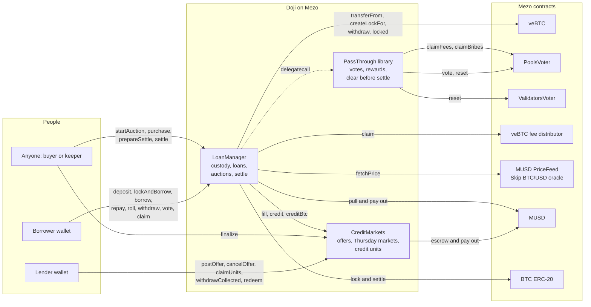
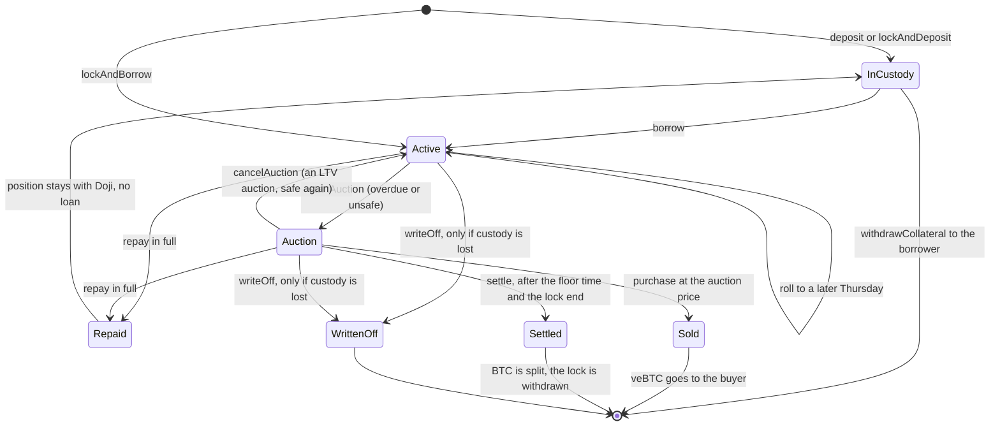
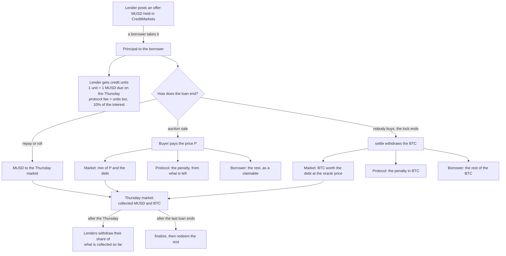

Doji lends MUSD against veBTC on Mezo at a fixed rate until a fixed Thursday. Two immutable contracts hold everything: `CreditMarkets` (lender offers and one market per Thursday, with ERC-1155 credit units) and `LoanManager` (custody of veBTC positions, loans, auctions and settlement). A keeper script on GitHub Actions calls the same public functions anyone can call. The website reads the chain directly; there is no backend and no database.

## 1. How the pieces connect

## 2. A loan's life

Every ending reduces its Thursday market's open-loan count by exactly one. When the Thursday has passed and that count is zero, anyone can call `finalize` and the market's lenders can redeem.

## 3. Where the money goes

Each Thursday is its own market, so a loss on one date never touches another. Inside a date, every unit (lenders' and the protocol's) shares collections pro rata.

## What the website reads and writes

The app talks to the chain through wagmi and viem, reads addresses from a book keyed by chain id (generated from the deployment record) and simulates every write before the wallet sees it. Every sent transaction is confirmed from the RPC and Mezo's explorer together.

| Screen | Reads | Writes |
| --- | --- | --- |
| Landing | veBTC `supply` and PriceFeed `fetchPrice` on Mezo mainnet; open offers (`nextOfferId`, `offerOf`), `marketOf` per Thursday, risk settings, open auctions, explorer verification | none |
| Borrow | offers, `quoteFill`, `fetchPrice`, risk settings, the wallet's veBTC (`balanceOf`, `ownerToNFTokenIdList`, `escrowType`, `grantManager`, `lockOf`) and positions Doji holds for it | BTC `approve`, `lockAndBorrow`; or veBTC `approve`, `deposit`, `borrow` |
| Lend | offers, `quoteFill`, the wallet's offers (OfferPosted logs), units per Thursday (`balanceOf`, `pendingUnits`, `claimOf`, `marketOf`) | MUSD `approve`, `postOffer`, `cancelOffer`, `claimUnits`, `safeTransferFrom`, `withdrawCollected`, `finalize`, `redeem` |
| My loans | positions from Deposited logs with `positionOf`, `loanOf`, `owedOf`, `collateralValue`, `lockOf`, `isUnsafe`, `isOverdue`, veBTC `voted`, fee distributor `claimable`, `claimableMusd`, `claimableBtc` | MUSD `approve`, `repay`, `roll`, `withdrawCollateral`, `claim` |
| Loan page | the same for any id, plus `auctionOf` and `auctionPrice` | `purchase`, `startAuction`, `cancelAuction`, `prepareSettle`, `settle` |
| Try to break it | live targets | none: twelve simulated calls that the contracts refuse |

The source of these diagrams is [ARCHITECTURE.md](https://github.com/ramakrishnanhulk20/doji/blob/main/ARCHITECTURE.md).
