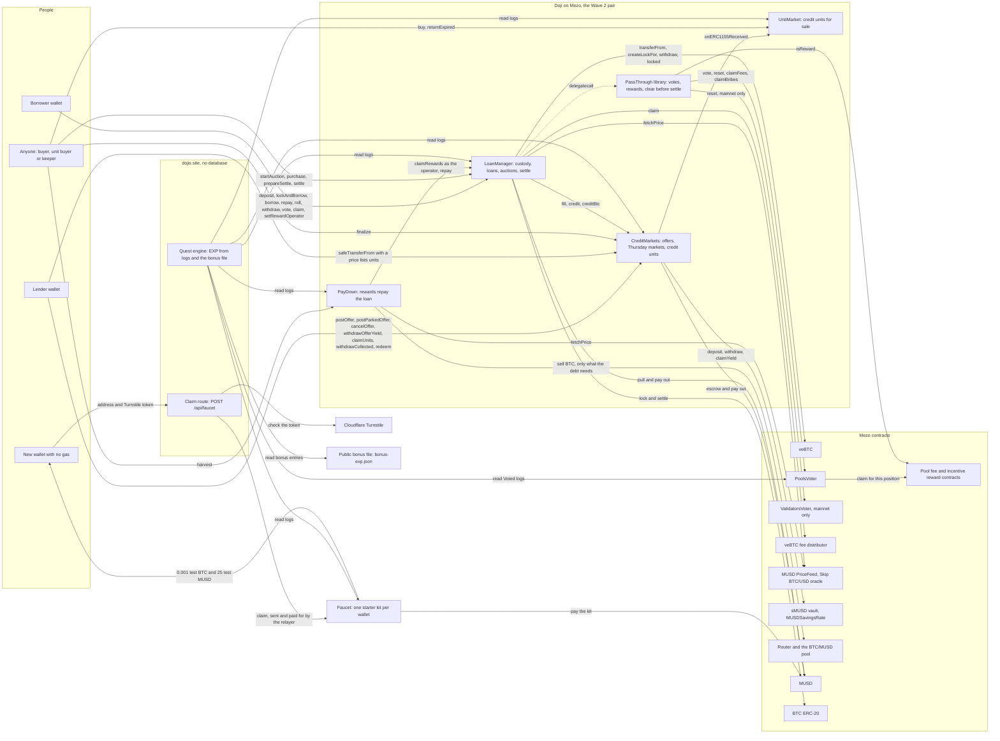
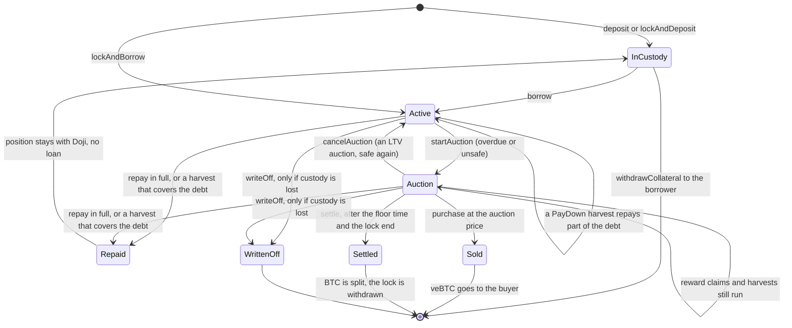
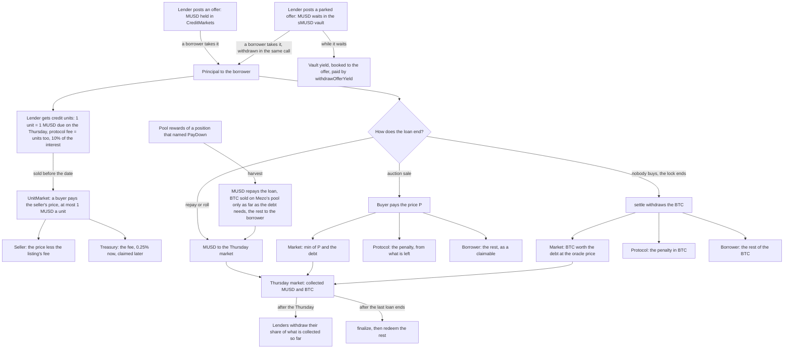

Doji lends MUSD against veBTC on Mezo at a fixed rate until a fixed Thursday. Each deployment is a pair of immutable contracts: `CreditMarkets` (lender offers and one market per Thursday, with ERC-1155 credit units) and `LoanManager` (custody of veBTC positions, loans, auctions and settlement). The Wave 2 pair, deployed on 4 November 2026, adds two more: `PayDown` (a position's pool rewards repay its loan) and `UnitMarket` (credit units for sale before their date), and its CreditMarkets can park an offer's waiting MUSD in Mezo's sMUSD vault. New offers and new loans go to the Wave 2 pair; the 20 October pair keeps serving every loan, offer, unit and auction opened on it. A keeper script on GitHub Actions calls the same public functions anyone can call, for both pairs. The website reads the chain directly and there is no database. Since 5 November 2026 a small server side backs the [quests](/docs/getting-started/quests): a `Faucet` contract pays a new wallet one starter kit, a claim route on the site checks Cloudflare Turnstile and has a relayer send the claim, and a quest engine turns contract logs and one public bonus file into EXP. Addresses for both pairs and the Faucet are on [Contracts](/docs/developers/contracts).

## 1. How the pieces connect

The 20 October pair has the same LoanManager, CreditMarkets and PassThrough without the Wave 2 parts: no PayDown, no UnitMarket, no sMUSD vault and no reward operator, and its reward claims accept only PoolsVoter's whitelisted tokens. ValidatorsVoter exists only on Mezo mainnet: both testnet records hold the zero address for it, so on testnet Doji passes votes to PoolsVoter only.

The Faucet, the claim route and the quest engine stand apart from the pairs. No Doji contract reads the Faucet or EXP, so a quest can never move a loan's money (C71). The Faucet holds test tokens only.

## 2. A loan's life

Every ending reduces its Thursday market's open-loan count by exactly one. When the Thursday has passed and that count is zero, anyone can call `finalize` and the market's lenders can redeem. A harvest changes a loan only by repaying it: as the reward operator, PayDown can call `claimRewards` for that position and nothing else (C36, C41).

## 3. Where the money goes

Each Thursday is its own market, so a loss on one date never touches another. Inside a date, every unit (lenders' and the protocol's) shares collections pro rata. Vault yield never enters a market or an offer's escrow, and it is paid only out of yield the vault actually delivered (C31). A unit sold on UnitMarket carries its whole claim on the date to the buyer.

## What the website reads and writes

The app talks to the chain through wagmi and viem, reads addresses from a book keyed by chain id, generated from the deployment records of both pairs, and simulates every write before the wallet sees it. Every sent transaction is confirmed from the RPC and Mezo's explorer together. New offers and new loans are built only on the Wave 2 pair. Everything a user already has (offers, loans, units, claims, auctions, loan pages) is read from both pairs, each item tagged with its pair, and written back to the pair that holds it. Nothing is identified by a maturity or a token id alone (C49).

| Screen | Reads | Writes |
| --- | --- | --- |
| Landing | veBTC `supply` and PriceFeed `fetchPrice` on Mezo mainnet; open offers (`nextOfferId`, `offerOf`), `marketOf` per Thursday, risk settings, open auctions, explorer verification | none |
| Borrow | offers, `quoteFill`, `fetchPrice`, risk settings, the wallet's veBTC (`balanceOf`, `ownerToNFTokenIdList`, `escrowType`, `grantManager`, `lockOf`) and positions Doji holds for it | BTC `approve`, `lockAndBorrow`; or veBTC `approve`, `deposit`, `borrow` |
| Lend | offers, `quoteFill`, the wallet's offers (OfferPosted logs, each kept only if `offerOf` names the wallet as maker), units per Thursday (`balanceOf`, `pendingUnits`, `claimOf`, `marketOf`) | MUSD `approve`, `postOffer`, `cancelOffer`, `claimUnits`, `safeTransferFrom`, `withdrawCollected`, `finalize`, `redeem` |
| My loans | positions from Deposited logs with `positionOf`, `loanOf`, `owedOf`, `collateralValue`, `lockOf`, `isUnsafe`, `isOverdue`, veBTC `voted`, fee distributor `claimable`, `claimableMusd`, `claimableBtc` | MUSD `approve`, `repay`, `roll`, `extendLock`, `vote`, `resetVotes`, `claimRewards`, `claimRebase`, `withdrawCollateral`, `claim` |
| Loan page | the same for any id, plus `auctionOf` and `auctionPrice` | MUSD `approve` and `purchase`, `startAuction`, `cancelAuction`, `prepareSettle`, `settle`; for the loan's borrower, the My loans writes |
| Try to break it | live targets | none: twelve simulated calls that the contracts refuse |
| Quests | the wallet's quest logs from Mezo's explorer and RPC, through one decoder (C67); Faucet `claimed`, `btcPerClaim`, `musdPerClaim` and the `Claimed` event of a claim; `/api/leaderboard` for the rankings | `POST /api/faucet` with the address and a Turnstile token, which the relayer turns into `claim`. The wallet signs nothing. The other quests link to Borrow, Lend and My loans, whose writes are above |
| A wallet's ledger, `/quests/<address>` | the same logs for that address; the share image reads the leaderboard's snapshot | none: an address from a URL is only ever displayed (C76) |

The Wave 2 parts of those screens, under rules C49 and C50:

| Screen | Reads | Writes |
| --- | --- | --- |
| Lend: "Earn in sMUSD while it waits" | `parkingOn`; for each parked offer `offerOf` (its `parked` flag), `isInVault` and `pendingOfferYield`; the wallet's `yieldOwedOf` | `postParkedOffer` instead of `postOffer` when the switch is on; `withdrawOfferYield` |
| Lend: "Credit units for sale" | UnitMarket `Listed` events, each listing re-read with `listingOf`; `quoteBuy` for the exact cost | listing by CreditMarkets `safeTransferFrom` to UnitMarket with `abi.encode(uint128 pricePerUnit, uint64 expiry)`; MUSD `approve` for exactly the quoted cost, then `buy`; `cancel`; `returnExpired` |
| My loans and the loan page: pay-down | `positionOf` (its `rewardOperator`); PayDown `Harvested` events for the position, re-read from the chain | `setRewardOperator(tokenId, PayDown)` to opt in, `setRewardOperator(tokenId, 0)` to stop |

The pay-down switch only ever names the PayDown in the address book, and a position whose operator is any other address shows a warning (C50).

Three things run on the server, none with a database.

- `POST /api/faucet` takes an address and a Turnstile token. It checks the format, then Cloudflare, then the chain, then simulates the exact call, and only then signs one `claim`, the only transaction it can sign (C59 to C64).
- `GET /api/leaderboard` returns the top 50 wallets, with Doji's own removed, from at most one scan a minute (C73, C75).
- The share image at `/quests/<address>` reads that snapshot and carries only values the code computed (C73, C77).

The quest engine is one module, [table.ts](https://github.com/ramakrishnanhulk20/doji/blob/main/packages/web/src/lib/quests/table.ts) and [exp.ts](https://github.com/ramakrishnanhulk20/doji/blob/main/packages/web/src/lib/quests/exp.ts), used by the browser, the leaderboard and the image, so all three give the same EXP from the same logs (C68, C69). A log counts only if a contract in the quest table emitted it at or after the Wave 2 deploy block (C67). An incomplete read is never shown as a final number (C70).

The source of these diagrams is [ARCHITECTURE.md](https://github.com/ramakrishnanhulk20/doji/blob/main/ARCHITECTURE.md).
